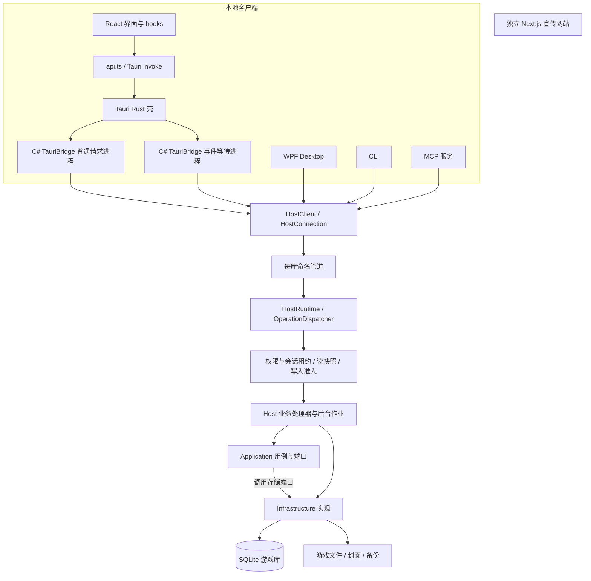
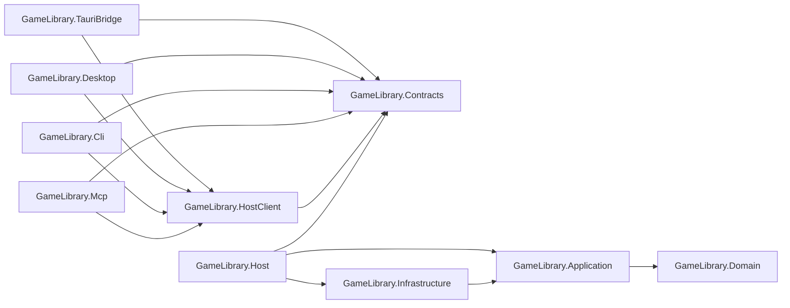

# GameLibrary 当前代码架构

2026-10-27，主程序 v1.8.0，宣传网站 v1.5.0。基础提交为 `316e3759b8c7203ae4c631150d96787c2fdab3db`（`main`），图谱已按当前工作区增量同步，插件返回 `status: ok`，无增量解析错误。

## 图谱快照

| 项目 | 当前值 |
| --- | ---: |
| 索引文件 | 425 |
| 节点 | 4,135 |
| 数据库关系 | 40,720 |
| 代码社区 | 28 |
| 社区间关联对 | 24 |

语言覆盖 C#、Rust、TypeScript、TSX、JavaScript、Python 和 PowerShell。社区结构来自插件；下面的模块名称、运行链路和项目引用方向已对照源码整理。

## 运行链路



运行图中的箭头表示请求或数据流。`Application` 调用存储端口，`Infrastructure` 实现这些端口；编译依赖方向见下一张图。

Rust 壳按 `operationId == "events.wait"` 选择事件通道，其余操作进入普通请求通道；两条通道分别持有 Bridge 进程。Bridge 通过标准输入输出收发 JSON，再由 `HostConnection` 连接命名管道。Host 持有游戏库连接，集中处理权限、会话和数据访问。

## C# 项目依赖

箭头严格对应各 `.csproj` 中的直接 `ProjectReference`，不展开传递引用。



`Domain` 和 `Contracts` 均无其他项目引用。`Application` 编排游戏目录、候选审核、备份创建和恢复用例；`Infrastructure` 提供 SQLite 与文件实现。Host 负责装配、IPC 分发以及扫描、启动、翻译等运行服务。

## 主要源码入口

以下路径相对于仓库根目录 `D:\Official\GameLibrary`。

| 模块 | 源文件或目录 |
| --- | --- |
| React 界面 | [App.tsx](../../src/GameLibrary.Tauri/src/App.tsx) |
| 前端共享状态 | [state.ts](../../src/GameLibrary.Tauri/src/lib/state.ts)、[hooks](../../src/GameLibrary.Tauri/src/lib/hooks/) |
| 前端请求封装 | [api.ts:118](../../src/GameLibrary.Tauri/src/lib/api.ts#L118) |
| Rust 请求与事件分流 | [lib.rs:232](../../src/GameLibrary.Tauri/src-tauri/src/lib.rs#L232) |
| C# Bridge | [BridgeServer.cs](../../src/GameLibrary.TauriBridge/BridgeServer.cs) |
| 命名管道客户端 | [HostConnection.cs:33](../../src/GameLibrary.HostClient/HostConnection.cs#L33) |
| Host 装配与生命周期 | [HostRuntime.cs](../../src/GameLibrary.Host/HostRuntime.cs) |
| 权限检查与请求分发 | [OperationDispatcher.cs:234](../../src/GameLibrary.Host/Hosting/OperationDispatcher.cs#L234) |
| 公共协议与权限配置 | [Contracts](../../src/GameLibrary.Contracts/)、[ClientPermissionProfiles.cs](../../src/GameLibrary.Contracts/ClientPermissionProfiles.cs) |
| 用例与端口 | [Application](../../src/GameLibrary.Application/) |
| 领域模型与引擎识别 | [Domain](../../src/GameLibrary.Domain/) |
| SQLite 连接与存储端口实现 | [SqliteLibraryStore.cs:16](../../src/GameLibrary.Infrastructure/Persistence/SqliteLibraryStore.cs#L16) |
| WPF / CLI / MCP 入口 | [Desktop](../../src/GameLibrary.Desktop/)、[Cli/Program.cs](../../src/GameLibrary.Cli/Program.cs)、[Mcp/Program.cs](../../src/GameLibrary.Mcp/Program.cs) |
| 独立宣传网站 | [MarketingPage.tsx](../../website/components/MarketingPage.tsx)、[GlassControls.tsx](../../website/components/GlassControls.tsx)、[app](../../website/app/) |

## 插件原生文件与复现命令

| 文件 | 绝对路径 | 内容 |
| --- | --- | --- |
| 交互架构图 | `D:\Official\GameLibrary\.code-review-graph\graph.html` | 插件原生 community 视图，可搜索、缩放、查看节点 |
| D3 运行文件 | `D:\Official\GameLibrary\.code-review-graph\d3.v7.min.js` | 与 HTML 一起保留，供本地图页使用 |
| JSON 导出 | `D:\Official\GameLibrary\.code-review-graph\graph.json` | 插件导出的节点、边、社区和执行流 |
| 图谱数据库 | `D:\Official\GameLibrary\.code-review-graph\graph.db` | 插件持久化索引；以上数据库统计来自此文件 |
| 架构 API 原始结果 | `D:\Official\GameLibrary\docs\code-review-graph\architecture-overview.json` | 28 个社区、24 对关联、耦合提示和提交元数据 |
| 本文与 Mermaid 源码 | `D:\Official\GameLibrary\docs\code-review-graph\architecture.md` | 可继续编辑的运行图、项目依赖图和源码入口 |

在仓库根目录执行：

```powershell
code-review-graph update --repo D:\Official\GameLibrary
code-review-graph visualize --repo D:\Official\GameLibrary --mode community --format html
code-review-graph visualize --repo D:\Official\GameLibrary --mode community --format json
```

`.code-review-graph` 下的导出和数据库由插件忽略，不提交到 Git；`docs/code-review-graph` 保存可跟踪的架构说明与 API 快照。

## 读图边界

数据库有 40,720 条关系；本次 JSON 的 `edges` 数组含 19,362 条边、`flows` 数组含 100 项。导出集合与数据库总数口径不同，应分别读取，不能把导出集合当成完整数据库。

32,270 条 `CALLS` 中，插件报告直接解析 9,062 条、未解析 23,208 条。跨语言 IPC、动态分发和同名方法仍需对照源码，图上的关联不能直接当作运行时调用事实。

插件给出 15 条高耦合提示，其中包括 Host 与集成测试、Infrastructure 与集成测试的关系；测试对生产代码的引用不单独构成重构理由。生产社区中 Host 与 Infrastructure 关联 212 条，可在后续重构审计中继续追踪；本次未据此修改架构。

本次完成索引同步、原生 HTML/JSON 导出与文档更新，未运行测试、构建、lint 或类型检查。SVG 导出因本地缺少 `matplotlib` 未完成。

早期实现记录仍见 [优化实施记录](optimization-implementation.md)、[名称翻译](../title-translation.md)、[Unity 加载器兼容](../development/v1.7.11-loader-compatibility-plan.md)和[网站实施记录](website.md)。
