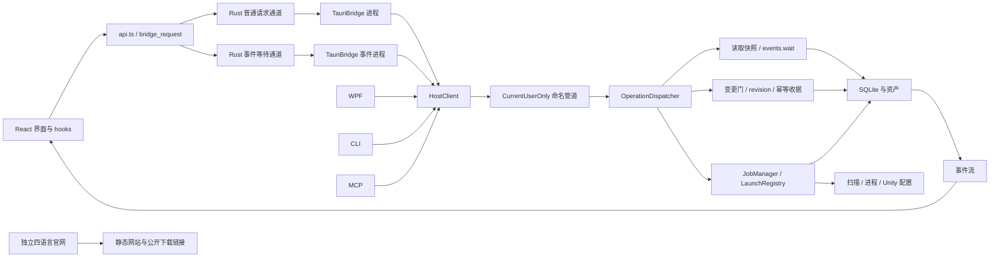
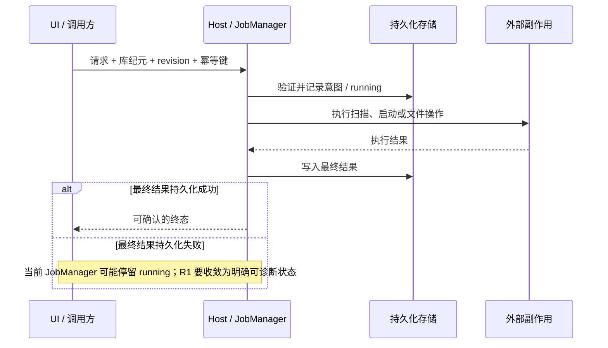

# GameLibrary 深度代码审查与分阶段优化方案

审查日期：2026-10-14（Asia/Singapore）。源码基线：`a3fe0d133fb97367abefda751dc01a2f4b791a27`，分支 `main`，主程序源码版本 `1.7.13`，官网源码版本 `1.3.0`。

本轮目标：正确性与可靠性优先；覆盖全仓，以桌面主程序为重点；保持现有功能、持久化数据和对外接口兼容，分阶段小步优化。本文是审查与实施建议，不代表已修复这些问题。

本文路径相对仓库 `D:\Official\GameLibrary`，行号对应上述提交。文件规模包含注释、空行，前端统计包含同目录测试，不能直接当作复杂度、缺陷率或覆盖率。证据标为“源码事实”“静态推导”“待验证”，避免把审查推理写成运行结果。

## 1. 审计结论与当前进度

当前仓库已经具备完整的本地游戏库主链路：多客户端接入 Host，扫描与候选审核，游戏及启动配置管理，作业与事件，名称翻译和 Unity 配置，备份恢复与维护状态，以及四语言官网。它不是需要整体推倒重建的原型。

最值得先修的是异常路径的状态一致性：**作业执行结束但终态持久化失败、详情页异步结果跨游戏回写，以及安装器按进程名强制关闭无关实例**。简介草稿、共享 IPC 的取消和版本拒绝语义、封面失效后的恢复、审计日志并发紧随其后。性能优化应从重复请求和数据驻留入手，取得基准后再决定是否引入并行连接、虚拟化或查询协议变化。

本轮没有形成 P0 级问题的充分证据；这不等于完整安全认证或证明不存在 P0。发现的高优先级问题均有源码路径支持，但未运行故障注入或界面复现。

### 1.1 已有能力，不应重复建设

| 已确认的源码事实 | 证据 | 对方案的约束 |
|---|---|---|
| Host 已区分普通读取、变更和长轮询，读取使用会话租约和 SQLite 快照 | `src/GameLibrary.Host/Hosting/OperationDispatcher.cs:200-314`；`src/GameLibrary.Infrastructure/Persistence/SqliteLibraryStore.cs:50-90` | 不再建议“把所有请求从一个全局锁拆出来” |
| 查询卡片附加字段、资产、标签和译名已有批量装配 | `src/GameLibrary.Infrastructure/Persistence/LibraryCatalogStore.Games.cs:115-185` 及同文件 `EnrichGameCards` | 不把当前查询误判为逐游戏 N+1 |
| 扫描候选批次事务提交后才发布事件 | `src/GameLibrary.Host/Scanning/ScanCandidatePersistence.cs:38-140` | 保留这条事务与事件顺序 |
| 备份将数据库快照和资产复制放在共同写锁内；恢复有暂存、校验、安全备份、journal、回滚和启动收敛 | `src/GameLibrary.Infrastructure/Backups/LibraryBackupStorage.cs:14-20`；`src/GameLibrary.Infrastructure/Backups/LibraryRestoreStorage.cs:48-151` | 不为了提高并发而拆散一致性边界 |
| 游戏删除已有 moving 意图、revision 和 reparse 检查；启动已有准备与执行分离 | `src/GameLibrary.Host/Hosting/GamesHandler.cs:451-639`；`src/GameLibrary.Host/Launching/LaunchRegistry.cs:398,509` | 不重复提“先记意图再做副作用”作为新架构 |
| Pipe 已有同用户限制、客户端上限和握手/空闲读取预算 | `src/GameLibrary.Host/Ipc/PipeServer.cs:16-18,55,90-95` | 历史报告中“无限连接、无握手超时”不是当前事实 |
| Tauri 普通请求与事件等待已经分通道，传输错误会丢弃对应 sidecar | `src/GameLibrary.Tauri/src-tauri/src/lib.rs:73-74,237-260` | 不重新实现长轮询隔离；普通通道仍串行是另一问题 |
| 游戏列表已有过期请求保护、串行刷新队列；卡片已有可见性懒加载与 `content-visibility` | `src/GameLibrary.Tauri/src/lib/hooks/useGamesQuery.ts:41-86`；`src/GameLibrary.Tauri/src/components/GameCard.tsx:26-55,74` | 保留这些机制，不能把前端说成完全没有优化 |
| Unity 引擎判定已有共享函数，配置有备份事务、哈希及路径校验 | `src/GameLibrary.Host/Hosting/UnityTranslationService.cs:66,501,680`；`src/GameLibrary.Host/Hosting/UnityTranslationTransaction.cs:36-128` | 不全局更改序列化、不迁移存量 `unity` 来适配错误大小写 |

### 1.2 覆盖范围与边界

| 范围 | 本轮审查深度 | 尚不能下结论的内容 |
|---|---|---|
| Host、HostClient、Pipe、TauriBridge、Rust bridge | 沿请求、会话、锁、重连、作业收尾和异常传播读取关键实现 | 实际超时分布、进程异常退出组合、外部程序行为 |
| Persistence、扫描、启动、备份恢复、Unity | 读取主链路与重要事务/故障收敛分支 | 所有文件系统故障组合、每个引擎和真实游戏兼容性 |
| React UI、API、hooks、封面、详情、审核 | 追踪列表刷新、异步回写、编辑草稿、缓存和分页 | 真机视觉、读屏、键盘完整流程、内存与帧耗时 |
| CLI、MCP、WPF | 检查共享边界、调用方式和项目依赖；WPF 为维护范围审查 | 不声称逐个 UI 事件或每个生成工具做过行为验证 |
| Contracts、Application、Domain、测试 | 检查依赖方向、标识符契约和对应测试源码 | 未计算覆盖率，未证明测试通过 |
| website、CI、发布文档、NSIS | 检查四语言、版本来源、构建和部署闸门；读取安装、升级、卸载及检查脚本关键分支 | 线上 CDN、下载资产、真实安装/升级/卸载及视觉验收未验证 |

这是覆盖各子系统、对关键链路深入的静态审查，不是对全仓每一行、全部平台或所有外部依赖的穷举证明。已有审查文档仅用作线索，发现须回到当前源码核对。辅助审查代理未返回可用结果，本文不依赖其结论。

### 1.3 规模与职责集中

| 区域 | 已跟踪代码文件数 | 物理行数 | 解读 |
|---|---:|---:|---|
| Application | 4 | 311 | 已有应用边界，但承载量较小 |
| Host | 57 | 16,177 | 用例编排、运行态和适配职责集中于此 |
| Infrastructure | 42 | 7,894 | 存储、扫描、文件系统实现 |
| Domain | 26 | 2,898 | 领域类型与规则 |
| Contracts | 13 | 1,081 | 公共协议与序列化 |
| HostClient / TauriBridge | 3 / 3 | 328 / 217 | 多客户端共享的通信入口 |
| Tauri React / Rust | 68 / 4 | 7,702 / 546 | UI 状态与进程桥接；React 含测试 |
| WPF / CLI / MCP | 15 / 3 / 3 | 4,503 / 1,680 / 1,070 | 仍有维护成本，不应忽略 |
| Integration / Unit / Contract / Architecture / Headless 测试 | 68 / 12 / 5 / 2 / 6 | 16,945 / 1,504 / 528 / 132 / 1,425 | 测试资产充分，不等于本轮异常场景已覆盖 |
| website app / components / lib | 6 / 2 / 3 | 67 / 265 / 49 | 规模小，结构性重构收益低 |

大文件集中在 `CatalogingHandler.cs`（1,093 行）、`OperationDispatcher.cs`（1,071 行）、`GamesHandler.cs`（947 行）、`ViewSettingsHandler.cs`（911 行）、`LaunchingHandler.cs`（848 行）、`LaunchRegistry.cs`（817 行）、`UnityTranslationService.cs`（786 行）、`DetailSheet.tsx`（758 行）。这些是阅读和变更成本信号，不单独构成缺陷。拆分应跟随下面的责任边界与失败用例，不能只按行数切文件。

## 2. 架构解读与图示

### 2.1 编译依赖与运行路径

项目引用关系是：Application → Domain；Infrastructure → Application；Host → Application、Infrastructure、Contracts；HostClient → Contracts；Desktop、CLI、MCP、TauriBridge → HostClient、Contracts。Domain 和 Contracts 没有项目引用。React 经 Tauri 命令进入 Rust，Rust 启动 .NET bridge，bridge 再通过命名管道调用 Host。

图中的箭头表示运行数据流，不把动态调用强行视为编译引用。官网不在本地 Host 调用链上。

架构的优点是多客户端共享契约和 Host 规则，修复 HostClient 或 JobManager 能同时改善多个入口。主要维护压力在 Host：协议验证、用例编排、存储协调、进程状态与恢复规则仍有交织。适合逐用例整理，不适合新建一套总线、仓储和通用工作流框架后整体搬迁。

### 2.2 三条必须守住的状态边界

1. 外部副作用与持久化不是同一个事务，不能用“内存标成功”代替可恢复结果。
2. 传输取消不证明 Host 没有执行；连接帧状态不明时不能继续复用，也不能随意重发写入。
3. UI 当前游戏、当前编辑会话和异步请求不是同一生命周期；仅比较 gameId 不能防止 A → B → A 的旧请求回写。

### 2.3 图谱使用与限制

审查期间调用了 `code-review-graph` 架构概览和调用查询。图谱基线 SHA 与审查源码 SHA 一致，更新时间为 `2026-10-13T14:34:21`。对 `HostConnection.InvokeAsync` 的限定名查询返回 69 个调用位置、56 个节点，其中 58 条直接解析、11 条未解析；这说明共享入口影响广，不代表 69 个真实缺陷。

图谱返回的 18 个社区和 `cross_community_edges=0` 不能解释为实际零耦合。裸名查询存在同名歧义，委托和动态装配也有盲区，最终结论均结合源码。此次只新增审查文档并更新图谱文档入口，不改变源码结构；不把文档提交后的 SHA 差异描述为代码图谱已经重新构建。

## 3. 正确性与可靠性发现

优先级：P1 = 优先处理可能造成错误状态、阻碍恢复或错误操作的路径；P2 = 在特定条件下产生明确错误、数据编辑损失或功能缺口；P3 = 测量后决定的成本优化。排序同时考虑影响和当前可达性。

| 编号 | 优先级 | 发现 | 证据强度 |
|---|---|---|---|
| R1 | P1 | 作业终态落盘失败后，内存仍为运行态，但等待任务已完成 | 直接控制流与真实落库回调；故障未运行注入 |
| R2 | P1 | 详情页旧异步操作可把 A 游戏回写到 B 的详情会话 | 已核对父组件复用、关闭和导航路径；UI 未运行复现 |
| R3 | P2 | 简介草稿缺少 dirty/revision 基线保护，刷新或冲突可覆盖输入 | 直接赋值与保存路径；UI 未运行复现 |
| R4 | P2 | HostClient 请求取消或协议错误后可能复用帧状态不明的连接 | 公共 API 控制流成立；多数当前适配器使用不可取消 token，不能说日常已频繁触发 |
| R5 | P2 | 拒绝不兼容协议时回显客户端版本，客户端误判握手成功 | 服务端和客户端条件直接矛盾 |
| R6 | P2 | 全局封面失效使无关在途加载失败，卡片不自动重试 | 缓存、API、事件、组件链路完整 |
| R7 | P2 | 审计队列有多个消费者，并发落盘/轮换失败可能静默丢记录 | 并发可达、无单写者；发生比例待验证 |
| R8 | P2 | 候选审核只暴露前 1,000 项，没有后续分页 | 固定请求与组件接口已核对 |
| R9 | P1 | 安装/卸载按进程名强制结束所有可终止的同名实例 | 两处安装器分支明确使用 `/F /IM`，测试构建跳过该分支 |

### R1 — 作业终态持久化失败没有收敛路径

**源码事实。** `src/GameLibrary.Host/Hosting/JobManager.cs:236-251` 只捕获 executor 的异常。随后 `src/GameLibrary.Host/Hosting/JobManager.cs:253-272` 在锁内先 `Record(entry, snapshot)`，成功后才设置 `entry.State`；外层只有 `finally { entry.Completed.TrySetResult(); }`。`src/GameLibrary.Host/HostRuntime.cs:229-237` 将普通作业的记录回调绑定到同步 `Store.UpsertJobRecord`，因此这里确实可能遇到存储异常。`src/GameLibrary.Host/Hosting/JobManager.cs:174-176` 启动的任务未被调用方等待。

**触发与影响（静态推导）。** executor 已结束，终态写入因磁盘、锁或 I/O 异常失败：`entry.State` 留在 `running`/`cancelRequested`，`WaitForIdleAsync` 的 completion 却已完成；`ActiveJobCount` 仍把它计为活动作业。前端 `jobs.get` 等待不到终态，基于活动作业数的维护判断也可能持续拒绝。异常发生在 detached task 上，不能依靠请求信封把失败反馈给用户。

**最小修复。** 保留“持久化成功后才发布成功终态”。单独处理收尾持久化异常，区分执行结果与结果是否已可靠记录；内存必须进入明确可诊断的失败/需恢复路径，同时保留原执行结果用于恢复。无法保证落盘时不能继续声称 durable success，也不能单纯减计数后允许维护操作无条件穿过。优先接入既有恢复/维护错误语义，避免先扩展所有客户端的状态枚举。观察后台任务异常；日志自身失败不得再次遮住根因。

**文件。** `src/GameLibrary.Host/Hosting/JobManager.cs` 为修复主点；`src/GameLibrary.Host/HostRuntime.cs` 只在需要接入维护状态或诊断时改；测试放入已有 `tests/GameLibrary.IntegrationTests/Scanning/JobManagerTests.cs`。

**建议验收。** 让记录回调仅在终态抛异常，证明不会永远 running、不会假报 succeeded、执行器不会被重新执行，WaitForIdle、活动计数、维护许可和 `jobs.get` 语义一致；恢复落盘能力后可收敛。现有 `TerminalState_IsPublishedAfterFinalRecord`（同测试文件第 9 行）验证的是终态记录阻塞后成功，不覆盖记录抛异常；应保留原测试并补这一个失败场景。

### R2 — 详情页请求缺少统一的会话与序号保护

**源码事实。** `src/GameLibrary.Tauri/src/App.tsx:365-384` 持续复用未带 key 的 `DetailSheet`，关闭和导航仍可发生。`src/GameLibrary.Tauri/src/components/DetailSheet.tsx:232-241` 的 `toggleTag` 在等待写入及再次读取后直接 `setCurrent(refreshed.data)`，没有当前游戏或会话校验。`src/GameLibrary.Tauri/src/components/DetailSheet.tsx:184-195` 的公共 `run` 也未隔离旧操作的 error、busy、confirmDelete 收尾。`load` 仅在部分成功路径检查 gameId，没有同游戏请求序号和 revision 防倒退，catch 不检查会话。

**触发与影响（静态推导）。** 在 A 的标签操作尚未返回时关闭详情并打开 B，或沿相似游戏导航到 B，A 的晚到 `games.get` 可把 `current` 改回 A。之后按钮读取的是 `current.gameId`，可能让用户在认为仍选中 B 时对 A 操作。A → B → A 时，单独增加 gameId 判断仍挡不住第一轮 A 的旧结果。旧 finally 还可能解除新会话的 busy。

**最小修复。** 在详情组件的共同异步边界维护会话代数和请求序号；导航/关闭使代数失效。成功、失败、finally 的 UI 写入全部经过相同有效性判断；同游戏数据合并保留较新 revision。先在现有组件内修完整，再按需要提取一个专用 hook。不要仅给标签按钮补 guard，也不要用禁止关闭代替生命周期正确性。后端已经执行的写入仍需正常完成，UI 丢弃旧显示结果不等于撤销业务操作。

**文件。** `src/GameLibrary.Tauri/src/components/DetailSheet.tsx`、`src/GameLibrary.Tauri/src/components/DetailSheet.test.tsx`；`src/GameLibrary.Tauri/src/App.tsx` 只在需要显式传入会话状态时改，不新增路由库。

**建议验收。** 用可控制完成顺序的 Promise 覆盖 A 操作 → B → A 的成功/失败/收尾；B 的内容、错误和 busy 不受 A 干扰；同游戏旧 revision 不覆盖新 revision；关闭后重开不接受上次会话响应。

### R3 — 简介编辑与标题编辑保护不对等

**源码事实。** `src/GameLibrary.Tauri/src/components/DetailSheet.tsx:116-121` 对标题使用 `titleEdit.current.dirty`，对简介却每次无条件 `setSummaryDraft(detail.data.summary ?? "")`。简介保存取的是当下 `current.revision`（同文件第 202 行），而不是开始编辑时的基线。发生 `RevisionConflict` 后调用 `load()`（第 208-210 行），恰好又覆盖简介。简介输入在第 463-466 行通过 onChange 更新、onBlur 保存。

**触发与影响（静态推导）。** 初始详情请求较慢时用户已经开始输入；或失焦保存产生冲突并刷新；或其他操作触发 load，尚未确认的简介会被服务器值替换。编辑期间服务端状态推进还可能让旧文本以较新的 current revision 提交，削弱本来应有的冲突提醒。不是所有刷新都会覆盖输入，但这些明确调用路径会。

**最小修复。** 复用标题的 dirty、gameId、编辑基线规则到简介；冲突时保留文本，更新服务器快照，要求用户明确重试，不能自动静默覆盖。保存成功仅清除本次提交的草稿版本，不能清掉保存期间的新输入。保持现有失焦保存交互，是否改成显式保存按钮另作产品决策。

**文件与验收。** 仍在 `src/GameLibrary.Tauri/src/components/DetailSheet.tsx` 和既有测试中完成。检查慢初载、冲突、保存中继续输入、切换游戏四条路径。现有标题草稿测试提供模式，不另建通用表单框架。

### R4 — IPC 取消之后必须明确连接是否还可复用

**源码事实。** `src/GameLibrary.HostClient/HostConnection.cs:77-112` 只对首次 `EndOfStreamException`/`IOException` 重连；取消、反序列化异常和 requestId 错误均不使现有连接失效。`src/GameLibrary.HostClient/HostConnection.cs:117-123` 先写帧、后读帧，响应 ID 不同就抛 `ProtocolError`，但保留 pipe。连接建立阶段第 51-59 行仅在 `TimeoutException` 时 dispose，其他连接失败也值得一起补资源收尾。

**触发与影响（静态推导）。** A 已写出，读取时取消；若 Host 随后把 A 响应写入 pipe，下一次 B 可能读到 A 并报 ID 错误。若在半帧处取消，后续 framing 也不再可信。正确的 ID 检查阻止了把 A 当 B 的成功结果，却没有恢复连接。当前 CLI、MCP、WPF 的多数调用使用 `CancellationToken.None`，TauriBridge 主要传生命周期 token；因此这是共享 API 的确定失败路径与后续取消能力的前置修复，不报告为所有客户端已发生的日常故障。

**最小修复。** 等待发送锁之前取消不必动连接；开始写帧后若不能证明完整收发，应在同一发送锁保护下 dispose 并清空连接状态。下一请求通过明确的重连入口获得新连接。保留原请求 pin 住的 libraryInstanceId/dataEpoch 和幂等键语义，不在 catch cancellation 中自动重放写操作。连接建立的非超时失败也释放已创建 pipe。

**文件与验收。** 主改 `src/GameLibrary.HostClient/HostConnection.cs`，扩展 `tests/GameLibrary.IntegrationTests/PipeRoundtripTests.cs`，必要时同测试项目新增专门的 HostConnection 测试文件。用真实命名管道控制“请求已收到、响应暂缓”，取消 A 后再请求 B；B 必须收到自己的响应；半帧取消、错误 ID、取消等待锁分别验证，不用固定 sleep 猜竞态。

### R5 — 协议拒绝响应回显了错误的一方版本

**源码事实。** `src/GameLibrary.Host/Ipc/PipeServer.cs:122-129` 发现版本不匹配后返回 `new HandshakeResponse { ApiVersion = handshake.ApiVersion }` 并断开；`src/GameLibrary.HostClient/HostConnection.cs:163-170` 只比较响应版本与客户端自己的 `ApiConstants.ApiVersion`。拒绝响应因此仍与客户端预期相等，握手可被误认为成功，下一操作才暴露断线。

**最小修复。** 拒绝时返回 Host 实际支持的协议版本。现有响应字段和客户端检查已足够，不需要为这一修复升级协议。可另加缺失 Host 身份的校验作为完整性约束，但先确认旧客户端兼容，不把它与最小修复绑定。

**文件与验收。** `src/GameLibrary.Host/Ipc/PipeServer.cs`、`tests/GameLibrary.IntegrationTests/PipeRoundtripTests.cs`；真实握手发送不同版本，应立即识别 `HostVersionMismatch` 或返回可识别的 Host 版本，不能依靠后续 EOF 才发现拒绝。

### R6 — 封面全量失效缺少消费端恢复

**源码事实。** `src/GameLibrary.Tauri/src/lib/api.ts:97-98` 在任意 `assets.*` 写成功后清空资产缓存；`src/GameLibrary.Tauri/src/lib/hooks/useLibraryEvents.ts:67` 收到资产事件再清一次。`src/GameLibrary.Tauri/src/lib/assetCache.ts:11-15,27-29` 增加 generation，使旧在途结果拒绝。`src/GameLibrary.Tauri/src/components/GameCard.tsx:39-55` 吞掉失败，effect 仅依赖 `coverAssetId` 和 `visible`。

**触发与影响（静态推导）。** B 的封面还在加载时修改 A 的封面：全清使 B 这次加载拒绝；B 的 ID 和 visible 均未改变，即使列表重新 render，也不会重跑该 effect，可能一直显示占位图，直到重挂或依赖改变。缓存类测试已明确验证失效后的旧响应会拒绝；缺口在缓存与消费组件的组合，而不是这个 generation 检查本身。

**最小修复。** 库实例/纪元变化继续全清，不能放松旧库响应隔离。同一库单资产变化优先定向失效；若现有事件不能可靠提供受影响资产，则采用可订阅的失效版本和有界重新加载，合并 API 回执与事件重复通知。失效与真实读取失败应区分，不能无限无延迟重试，也不能把真实损坏图片永久变成 pending。

**文件与验收。** `src/GameLibrary.Tauri/src/lib/assetCache.ts`、`src/GameLibrary.Tauri/src/lib/api.ts`、`src/GameLibrary.Tauri/src/lib/hooks/useLibraryEvents.ts`、`src/GameLibrary.Tauri/src/components/GameCard.tsx`；复用 `assetCache.test.ts` 与 `GameCard.test.tsx`。验证 A 变更时 B 在途加载最终可恢复；切库后旧资产不能出现；失败重试次数有界。

### R7 — ConcurrentQueue 不保证文件写入只有一个执行者

**源码事实。** `src/GameLibrary.Host/Observability/AuditLogWriter.cs:85-101` 每个 Append 调用者都能同时进入 dequeue 循环；取出不同记录之后，会并行执行 `AppendCore`。后者第 104-116 行执行查文件、轮换、`File.AppendAllText` 和清理；没有共同文件锁。I/O 和权限异常被吞掉，已出队记录不再重试。Dispatcher 已允许读取并发，记录审计发生在请求收尾，故不是只能单线程触达的代码。

**触发与影响（静态推导）。** 多个完成请求同时落同一审计文件，可能产生共享冲突、轮换竞争、顺序颠倒；在实际冲突抛 I/O 异常时记录静默消失。业务请求不应被审计故障拖垮，但这不应等价于故障完全不可见。未测量当前机器上丢失概率。

**最小修复。** 让落盘与轮换共用一个简单 lock，必要时连队列都可删除；不急于引入 Channel、后台日志服务或新依赖。失败计数进入现有诊断；避免在锁内递归调用同一审计器记录自身失败。若诊断读取会与轮换互相影响，也沿同一所有权处理。

**文件与验收。** `src/GameLibrary.Host/Observability/AuditLogWriter.cs` 为主。扩展既有 `tests/GameLibrary.IntegrationTests/Observability/DiagnosticsTests.cs`，并发提交唯一 requestId，在不触发保留删除的配置下每条恰好可读一次；小文件轮换单独验证；模拟写失败时业务仍返回且诊断能发现失败。

### R8 — 审核队列缺少完整集合的浏览入口

**源码事实。** `src/GameLibrary.Tauri/src/lib/hooks/useLibraryMetadata.ts:60-62` 固定请求 `pendingReview`、`limit: 1000`、`offset: 0`。`src/GameLibrary.Tauri/src/components/ReviewList.tsx:13-21,66-94` 只接收并展示该数组，没有 total、loadMore 或分页状态。

**影响。** 超过 1,000 条时，用户需处理前面条目使后面条目进入第一页，不能直接继续浏览尾部。数据并未因此永久丢失，不能写成“第 1,001 条永远无法访问”。“全选”范围也需要说明是已加载项还是全部待审项。

**最小修复。** 沿已有候选查询支持加载更多，传 total、loading、hasMore；批量操作明确作用于已选择 ID。处理条目或扫描新增导致 offset 位移时刷新当前窗口并按 ID 去重，沿用游戏列表成熟模式，但保留独立的已消费位置/无进展处理，不机械复制其潜在分页边界问题。

**文件与验收。** `src/GameLibrary.Tauri/src/lib/hooks/useLibraryMetadata.ts`、`src/GameLibrary.Tauri/src/components/ReviewList.tsx`，按实际传参需要调整 `src/GameLibrary.Tauri/src/lib/state.ts`、`src/GameLibrary.Tauri/src/App.tsx`；若分页状态开始挤占 metadata，再新增专用候选查询 hook。造 1,001 条真实契约候选即可验证尾项可达；删除已加载项、后台插入、重复页和全选语义都要有明确结果。

### R9 — 安装器停机范围超过本次安装目录

**源码事实。** `artifacts/installer/GameLibrary.nsi:419-425` 在安装前执行 `taskkill.exe /F /IM GameLibrary.Desktop.exe` 和 `taskkill.exe /F /IM GameLibrary.Host.exe`；卸载在第 478-484 行重复。没有按可执行文件路径、安装实例或数据目录限定。第 3 行的 `RequestExecutionLevel user` 限制权限，但不会把同一用户的其他目录实例排除。`scripts/check_installer.py:3-4,34` 明确使用 `TEST_BUILD=1` 跳过 taskkill，所以该测试不能证明生产停机行为安全。

**触发与影响（静态推导）。** 当前用户同时运行已安装版与另一目录的便携版/开发实例，安装或卸载其中一个版本会尝试强制结束全部同名 Desktop/Host。其他库的扫描、翻译或文件事务会被非预期中断；是否实际损坏取决于各恢复机制，不能直接宣称必然损坏数据库。此路径绕过正常排空，比一般 UI 卡顿更应优先修复。

**最小修复。** 停机目标必须绑定实际可执行文件路径及本次安装范围；优先正常关闭、等待退出。无法可靠判断实例归属或无法安全停机时，提示用户关闭目标实例并中止/重试安装，比默认杀掉所有同名进程更可控。可复用既有 `host.stop`，但必须知道对应数据目录，不能猜测默认库就是目标。强制退出若作为后备，应限定已核验目标并明确提示。同步考虑 bridge 对父进程的监视，不另外按名称全局杀 bridge。

**文件与验收。** `artifacts/installer/GameLibrary.nsi`、`scripts/check_installer.py`；仅在现有 NSIS 能力不足时添加一个职责明确的辅助脚本，不扩展成进程管理框架。用两个隔离目录的无害同名进程桩覆盖生产停机判定：只影响目标目录；目标有未完成工作时正常排空或明确拒绝；未知文件、用户库和原游戏保持。测试应覆盖目标选择逻辑，不能仍把整段生产逻辑编译掉后宣称通过。本轮未运行安装器，也未执行任何停机命令。

## 4. 性能与资源优化：有依据的候选，不冒充实测瓶颈

### O1 — 控制一次变更引发的重复查询

**事实。** `src/GameLibrary.Tauri/src/lib/hooks/useGamesQuery.ts:106-129,134-159,182-197` 每次保留窗口刷新从第一页开始，串行补齐之前已经加载的项目。`src/GameLibrary.Infrastructure/Persistence/LibraryCatalogStore.Games.cs:153-172` 每页都执行 COUNT 和数据查询。`src/GameLibrary.Tauri/src/lib/hooks/useLibraryMetadata.ts:55-57` 又用 `games.list(limit:1)` 获取总数。详情的本地 `onChanged` 与事件驱动刷新还可能先后发生。`src/GameLibrary.Tauri/src/components/DetailSheet.tsx:109-112,163-170` 在初始挂载对 profiles 有两条读取路径。

**推导。** 若已加载 600 项、每页 60 项，保留窗口刷新在数据稳定时约需 10 个 `games.list`，通常也有 10 次 COUNT；这只是调用次数推导，不是耗时测量。连续变更会放大 bridge 排队与数据库工作。

**实施顺序。** 先合并同一批本地完成与事件刷新、去掉重复 profiles 初载；复用现有 `useGamesQuery.patch` 更新已知游戏。凡变更会影响筛选成员、排序位置或总数，仍需使查询窗口失效，不能只 patch 卡片而留下错误列表。再研究同窗口刷新共享一次 total、轻量计数投影或批量窗口读取，保持旧 `games.list` 响应兼容。没有证据前不引入全局缓存框架或替换分页协议。

**测量与准入。** 记录一次收藏/标签/封面操作引起的列表请求数、COUNT 次数、详情可交互时间；比较 60/600/3,000 个已加载项，分别冷缓存和热缓存。第一轮目标是减少重复调用且不改变结果，不承诺未经测试的倍数提升。

### O2 — 普通 bridge 通道存在队首等待

**事实。** `src/GameLibrary.Tauri/src-tauri/src/lib.rs:237-256` 只有 `events.wait` 走 events 通道，其余请求在单个 requests Mutex 内等待完整响应；`src/GameLibrary.Tauri/src-tauri/src/lib.rs:63,87-109` 单次响应等待预算为 120 秒。React 的 `Promise.all` 不等于这些 IPC 请求能并行完成。

**建议。** 先做 O1，并在请求进入 Rust、取得 lane、收到 bridge 响应三个时间点观察排队和执行耗时。只有大封面或长读确实阻塞交互时，才考虑一个有界的额外只读通道。保持写入顺序，库纪元变化须同时失效所有连接；错误后丢弃对应进程的行为保留。不要移除 Mutex 让多请求混写同一条 stdin/stdout，也不要为每次点击启动新进程。

**代价。** 增加通道会增加进程、重连和关机协调复杂度，尤其 `src/GameLibrary.TauriBridge/Program.cs:26-32` 在带 parentId 的 bridge 退出时会请求停止 Host。应先明确 bridge 的停机所有权，不能只改 lane 数量。

### O3 — DOM 和封面驻留未受缓存预算整体约束

**事实。** `src/GameLibrary.Tauri/src/components/GameGrid.tsx:98,142` 渲染所有已加载卡片；IntersectionObserver 实现的是加载更多，不是列表虚拟化。`src/GameLibrary.Tauri/src/components/GameCard.tsx:22-55` 将 data URL 留在卡片 state，可见后不再恢复不可见状态。`src/GameLibrary.Tauri/src/lib/assetCache.ts:9` 的 64 MiB 预算只管理缓存 Map，不能回收组件引用及浏览器已解码图片。现有 `content-visibility:auto` 已降低部分屏外渲染成本。

**低成本先行。** `src/GameLibrary.Tauri/src/components/GameGrid.tsx:49-56` 的 toggle 每次 render 新建，选择集合清理也总是创建新 Set；先稳定回调、无变化返回原 Set，维护 `memo(GameCardImpl)` 的收益。再测滚动 1,000/5,000/10,000 项后的 DOM 数、JS 堆、图片内存和长任务。只有驻留持续超过可接受范围时再引入窗口化；评估键盘焦点、选中项、滚动恢复、屏幕阅读器和布局列数变化。若采用 Blob URL 或本地资产协议，必须定义 revoke/授权/路径验证，不能仅为了省 Base64 放开任意本地文件读取。

### O4 — 作业和启动注册表需要按语义保留，不宜无限驻留

**事实。** `src/GameLibrary.Host/Hosting/JobManager.cs:81,159-170` 将作业加入字典，普通完成路径不移除；entry 留有 CTS、Context 和 FinalData。`src/GameLibrary.Host/Launching/LaunchRegistry.cs:137-141` 也保留 plans、attempts、receipts 等运行态索引。

**建议。** 先观察长期开机时终态数量和体积，保留活动作业与有限终态缓存；有可靠持久化历史的记录可以按时间/数量清理。必须先补 `jobs.get`/重放的回读路径，再移除内存数据；不能删除 receipt 后让重试再次执行副作用。运行态 CTS 在确定无消费者后释放。建议优先处理 JobManager，不同时重写所有 registry。

### O5 — 审计查询读取全部历史，写入也逐条扫描文件集合

**事实。** `src/GameLibrary.Host/Observability/AuditLogWriter.cs:163-168` 用 `SelectMany(File.ReadAllLines).TakeLast(count)`，即使只请求几行也读取所有保留文件。默认策略最多约 10 × 10 MiB。第 104-116 行每条记录又进行过期扫描、文件选择和数量裁剪。

**建议。** 在完成 R7 单写者修复后，按最新文件向前读取到足够行数即停止，保持返回顺序；写入缓存当前文件信息，并在轮换点或适当周期清理。优先标准库的小改动，不先建日志索引库。用实际保留上限测 diagnostics.logs 的 I/O 和延迟，再决定是否需要更复杂的逆向读取。

### O6 — 扫描预算在单个超大目录内可能失去时效

**事实。** `src/GameLibrary.Infrastructure/Scanning/DirectoryWalker.cs:19-23` 默认最多 20,000 个目录、120 秒预算；`src/GameLibrary.Infrastructure/Scanning/DirectoryWalker.cs:350-375` 先将当前目录的全部子目录与文件收集到 List。循环检查取消，但时间/目录预算不足以约束一个目录的项数与本次枚举耗时。

**建议。** 先测一个目录内极多文件的场景；把已存在的截止时间传到枚举循环，必要时流式处理或限制候选摘要保留。达到预算要报告 partial coverage 并能继续，不能静默截断并误报扫描完成。若检测器需要完整目录集合，先梳理消费者，不能把 List 机械改成 iterator 后多次枚举导致不一致。

### O7 — 查询优化必须基于具体形状

**事实。** `src/GameLibrary.Infrastructure/Persistence/LibraryCatalogStore.Games.cs:115-182` 按标题显示模式组合字段/译名子查询，并支持 LIKE 筛选与排序。当前卡片装配已批量化。

**建议。** 使用隔离数据库的真实字段分布，对“无筛选分页、名称搜索、标签筛选、按入库时间排序”分别记录查询计划与耗时。只有看到扫描或排序代价后再选索引、投影或 FTS；如果是含前导通配符的子串搜索，不能假定普通索引必定解决。不要在未取得基准时迁移用户数据或加入 FTS schema。COUNT 优化与 O1 一起判断，避免优化错层。

## 5. 维护性、契约和安全边界

### 5.1 Host 的整理应跟随用例，不按目录搬家

Application 目前已有 `src/GameLibrary.Application/Catalog/GameCatalogService.cs`、`src/GameLibrary.Application/Catalog/CandidateReviewService.cs`、`src/GameLibrary.Application/Backups/BackupCreateService.cs`、`src/GameLibrary.Application/Backups/BackupRestoreService.cs`。应复用这些边界，只在某个用例确有跨入口复用或复杂编排时提取，不为每个 Handler 建一层空转发。

优先顺序是：先修 R1 和共享连接；再使 Handler 只负责协议解析/权限/revision/信封映射，把可独立说明的用例编排放到已有应用服务。进程、SQLite 与文件系统细节仍由其实际所有者维护；Host 保留组合与生命周期管理。`OperationDispatcher` 目前统一的变更门、收据和会话租约不能随拆分散落到每个 Handler。

一次只迁一个用例，接口与数据库不变，旧测试保持；目录移动和行为修复分开提交。不要把较长的 `UnityTranslationService` 一次拆成多个可插拔策略，当前串行队列、事务和回滚关系比形式上的文件短更重要。

### 5.2 跨层字符串必须按真实契约处理

`src/GameLibrary.Contracts/ContractJson.cs:17` 使用 camelCase 枚举转换；Unity 的公共表示为 `unity`，不是枚举名 `Unity`。当前 `src/GameLibrary.Host/Hosting/UnityTranslationService.cs:66` 已有共享兼容判断。

后续涉及 engine/state/kind/provider 时，逐个确认“生产者 → ContractJson/生成契约 → DB/API → UI 判断”。复用所有者的判断函数；不要建立一个把所有标识符无条件 lower-case 的公共函数。权限、路径比较和其他标识符未必共享相同大小写语义。回归输入通过真实扫描/公共序列化生成，不能把实现里猜出的值复制到 fixture 后证明自己正确。

operation 已有单源生成和 CI 检查，应继续让新增/变更来自单源定义。手工维护的 DTO 边界可针对实际漂移补契约样例，不建议为了“类型统一”一次生成所有前后端代码。

### 5.3 当前 IPC 信任的是本机同用户进程

`src/GameLibrary.Host/Ipc/PipeServer.cs:55` 使用 `CurrentUserOnly`；`src/GameLibrary.Contracts/Ipc/WireMessages.cs:42-47` 明确 permissions 缺省/null 表示第一方不限权；`src/GameLibrary.Host/Hosting/OperationDispatcher.cs:394-405` 与之匹配，显式 permissions 中 `access.admin` 也不是通配授权。

因此，**客户端自报 permissions 是协作约束，不是对同用户恶意进程的身份鉴别**。不能把它描述成远程未授权入口，也不能对外承诺受限 MCP 可抵御同用户进程伪装成第一方。是否需要更强身份/授权取决于产品是否把这类本地代理视为不可信；这是需要确认的威胁模型，不在兼容小修里暗中改变 null 的含义。

`src/GameLibrary.Contracts/Ipc/IpcFrame.cs:10,27-44` 已限制命名管道帧为 8 MiB，不应再称 IPC 无长度上限。但 Rust sidecar 的 `read_line` 和无界 mpsc（`src/GameLibrary.Tauri/src-tauri/src/lib.rs:112-131`）属于另一条进程内信任边界，可在异常 bridge 输出测试后增加明确的行长度/排队上限。它优先级低于 R1/R2/R9，不能把受控 sidecar 异常夸大成已确认的远程攻击。

### 5.4 CLI、MCP、WPF 的边界改动

`src/GameLibrary.Mcp/GameLibraryTools.cs:633-638` 使用同步等待连接，诸多调用传 `CancellationToken.None`；CLI、WPF 也存在不可取消的共享调用。等 R4 定义好帧取消语义后，再给真正长时操作传有边界的取消预算，不要把所有同步方法机械 async 化。请求取消后的 UI 应显示“结果待确认/可刷新”，不能把 Host 可能已提交的写入当作没有发生。

WPF 与 Tauri 双前端确有维护成本，但目前不能仅以重复代码为由删除 WPF。依照已有迁移记录，先维护功能差异清单，待 Tauri 对等且满足既有稳定版观察条件，再单独决定退出支持。本轮不改变入口和发布包组成。

### 5.5 其他待确认点，不升格为已确认高危发现

| 线索 | 依据 | 下一步与边界 |
|---|---|---|
| 启动等待无总时长预算 | `src/GameLibrary.Tauri/src/lib/state.ts:187-204` 以 300 ms 周期持续轮询直至终态或卸载 | R1 修复后再评估；长启动可能是正常业务，UI 退出等待不等于取消 Host 副作用 |
| 事件重建 baseline 失败会产生未处理拒绝 | `src/GameLibrary.Tauri/src/lib/hooks/useLibraryEvents.ts:81-91` 在 catch 内 await baseline，定时调用 void poll | finally 仍安排下一轮，不能误报成永久停止轮询；补错误观测和有界恢复即可 |
| offset 与去重后长度不是同一概念 | `src/GameLibrary.Tauri/src/lib/hooks/useGamesQuery.ts:161-179` 使用 gamesRef 长度作为下一 offset | 动态列表大量插入可能重复/进展慢；refresh 已有第 126-127 行无进展 guard，不能声称其必然死循环；先构造真实排序位移再改协议 |
| bridge 退出与 Host 停机所有权可能耦合 | `src/GameLibrary.TauriBridge/Program.cs:26-32`；`src/GameLibrary.TauriBridge/BridgeServer.cs:105-119` | 区分父窗口退出、单 lane 故障和 Host 被其他客户端使用；不能因为 finally 有 stop 就声称 Rust 强杀一定会执行 finally |
| 初始化能力快照只缓存一次 | `src/GameLibrary.Tauri/src/lib/hooks/useLibraryMetadata.ts:30-40` | 若未来支持运行中升级 Host 或换数据目录，明确定义何时失效；当前没有充分证据列为可见故障 |

## 6. 官网、CI 与发布链

### 6.1 官网保持小而独立

`website/lib/site.ts:3-8,14-25` 有四语言、独立公开稳定版常量 `1.7.13`、生产路径与语言元数据；MarketingPage 的下载资产与截图标注已按公开版维护。源码中的日期/版本不是本轮重新验证线上状态的证据。

建议继续让官网稳定版与开发版概念分开；不要直接把 `Directory.Build.props` 的最新开发版本注入公开下载链接。增加版本时以实际发布资产为依据，在既有 `scripts/check_website.py` 的约束内维护四语言与链接。现有 `website/lib/glass.ts` 的小型样式兼容 helper 无需另建设计系统；`website/lib/theme.ts` 的 bootstrap 产物行为尚未验证，不列为确定 bug。

此次不建议重构 Next 路由或状态，也不引入 CMS。真机视觉、键盘与下载检查待另行授权验证。未来写 Next 代码前，按 `website/AGENTS.md` 读取该项目本地 Next 文档。

### 6.2 CI 配置覆盖广，但本轮未执行

`.github/workflows/ci.yml:24-43,76-96` 配置 operation 生成、本地化、release checker、format、Release build、.NET tests、前端 tests/typecheck/build、sidecar 和 Rust 检查。`.github/workflows/website.yml:47-62` 的部署要求 `workflow_dispatch`、`inputs.publish` 和 main，普通 push 不自动部署。

这些是配置事实，不等同于当前提交 CI 已绿。适合优化的是把 R1-R9 的关键异常回归加到现有测试项目，让已有门禁能够捕获问题，不再新增一套平行测试框架。CI 是否耗时过长、是否需要更细缓存，须拿实际运行记录再决定。

### 6.3 安装与发布已有保护，补停机边界

`artifacts/installer/GameLibrary.nsi:494-500` 卸载枚举已知程序文件，最后非递归 RMDir；这与保留未知文件和用户库的要求一致。升级在第 402-410 行读取已有安装并等待卸载结果，非零则中止。应保留这些保护，优先修 R9。

`artifacts/tools/package_release.py:445-447,548-569` 记录源码提交、dirty 状态、检查状态及 not-run 原因；`scripts/check_release.py:145-155` 要求版本一致、人工验收 passed、必需检查存在且全部 passed，最后仍提示发布需要明确授权。没有依据要求重写发布工具。

后续若开始实施业务修复，遵守 `docs/release-policy.md`：版本真源为 `Directory.Build.props`，同步 Tauri 与 lock 产品项，SDK `10.0.401` 和 `global.json` 保持；普通修复不自动打包、推送或发布。本文只修改审查文档，不制造新产品版本或更新公开稳定版文案。

## 7. 前端文件级整理方案

先修行为，再按责任提取。所有“拟新增”文件仅为方案，当前仓库并没有因为本文而创建这些组件。

| 文件 | 第一轮最小修改 | 达到必要条件时的拆分 | 状态与路由影响 |
|---|---|---|---|
| `src/GameLibrary.Tauri/src/components/DetailSheet.tsx` | R2 全异步边界保护；R3 简介草稿；合并初载 profiles | 拟新增 `src/GameLibrary.Tauri/src/lib/hooks/useGameDetail.ts`，只拥有远端详情与会话；编辑草稿仍靠近编辑 UI | 保持现有 Sheet 和 App 选择状态，不加路由 |
| `src/GameLibrary.Tauri/src/components/DetailSheet.tsx` | 保留外部 props/回调签名 | 先提纯展示重块：拟新增同目录 `GameLaunchSection.tsx`、`GameCoverSection.tsx`；只有需独立维护时再提 `GameMetadataEditor.tsx` | 子组件接收快照和动作，不各自新建一套 games.get |
| `src/GameLibrary.Tauri/src/lib/hooks/useGamesQuery.ts` | 合并重复刷新，复用 patch，保留 revision 与请求取消保护 | 经测量后调整窗口读取/计数策略 | 查询仍是现有唯一列表来源，滚动与筛选语义不变 |
| `src/GameLibrary.Tauri/src/lib/hooks/useLibraryMetadata.ts` | 候选分页、减少仅取总数的完整卡片请求 | 分页职责增大时拟新增 `src/GameLibrary.Tauri/src/lib/hooks/useCandidatesQuery.ts` | metadata 保留 roots/tags/views 等集合；不新建全局 store |
| `src/GameLibrary.Tauri/src/components/ReviewList.tsx` | 明确已加载数量、总数、加载更多与批量范围 | 无需先拆组件 | 通过现有 state/App 接线，不增加页面路由 |
| `src/GameLibrary.Tauri/src/lib/assetCache.ts`、`api.ts`、`hooks/useLibraryEvents.ts` | 明确库全清和资产失效，合并重复通知 | 不新建通用 query cache | 保留纪元隔离和现有 data URL API |
| `src/GameLibrary.Tauri/src/components/GameCard.tsx`、`GameGrid.tsx` | R6 恢复、稳定回调、无变更保留 Set | 内存/长任务达不到目标时再窗口化 | 必须保留键盘、选中项与滚动位置 |
| `src/GameLibrary.Tauri/src/lib/state.ts` | 仅调整上述 hook 接线；已知变更优先精确刷新 | 经 Profiler 证明全 context 广播有成本后，拆数据/动作/作业 context | 不先引入 Redux、Zustand 或全局事件总线 |

迁移顺序：在原文件复现并修状态边界 → 证明行为稳定 → 提取纯展示区域 → 最后才考虑获取数据的 hook。禁止一边大范围移动组件、一边改状态语义，使回归无法归因。

回滚策略：每次改动单独提交；纯展示拆分可直接 revert；行为修复回滚需同时回滚相应新用例/接线并明确旧问题会恢复。第一阶段不做数据库迁移，不改变 operation ID 或公共响应字段。后续如性能方案必须加索引、协议字段或历史清理，另列迁移与反向兼容方案，不能混入 UI 拆分提交。

前端共同验收：打开/关闭/导航一致；输入不被异步刷新覆盖；筛选和排序下 patch 不漏项；候选尾页可达；封面可恢复且不跨库；键盘焦点可追踪；四语言不出现缺失 key；加载/失败/重试有明确反馈。此处是将来的验收标准，不是已完成验证。

## 8. 分阶段落地与优先级

工时是单人熟悉当前代码的规划区间，不含等候用户真机验收、发布或外部故障处理；不是交付承诺。每一阶段可独立停止，避免为了架构整齐扩大范围。

| 顺序 | 内容 | 预计工程量 | 出阶段条件 | 回滚与兼容 |
|---|---|---|---|---|
| A1 | R1 作业收尾异常 | 1–2 人日 | 终态写失败不假成功、不永久 busy；恢复语义一致 | 不改 operation/state 公共契约；单提交 |
| A2 | R2 + R3 详情会话与简介草稿 | 1–2 人日 | 跨游戏/同游戏乱序、冲突和编辑期间刷新用例明确通过 | 不改路由或数据结构；行为修复先于拆分 |
| A3 | R9 安装器目标实例限定 | 1–2 人日 | 两目录同名进程隔离、正常退出/拒绝安装可控 | 无数据库变化；生产停机选择逻辑必须被测到 |
| B1 | R5 握手拒绝 + R4 连接失效 | 1–2 人日 | 异版本握手立即失败；取消后下一帧正确，写入不盲重放 | 复用现有字段与错误；可按两个小提交交付 |
| B2 | R6 资产失效恢复 + R7 审计单写者 | 1–2 人日 | 无关封面恢复；并发日志不静默漏项且故障可观测 | 不新建缓存框架/日志服务 |
| B3 | R8 候选分页 | 0.5–1.5 人日 | 第 1,001 项可直接加载，选中范围明确 | 保持候选查询契约 |
| C | O1/O3 小改与基准；按结果选 O2/O4/O5/O6/O7 | 首轮 1–2 人日，后续按测量拆票 | 请求数、内存和延迟前后可比，结果集合一致 | 先无 schema/协议变化；必要扩展单独评审 |
| D | DetailSheet 纯展示提取；一个 Host 用例整理 | 2–4 人日，可分开 | 行为不变、责任更清楚、没有新增空转发层 | 文件移动和行为改动分开，逐提交可回退 |

A1、A2、A3 是第一批。R5 虽小且确定，可在同批单独快速提交，但不能因此推迟处理 P1。若时间仅够一天，先交付一个有完整失败用例的修复，而不是同时开始五个模块。

### 8.1 每个实施提交的要求

1. 在原始行为上构造最小失败输入，特别是异常收尾和异步完成顺序；输入遵循真实契约。
2. 查询现有图谱调用方，修复共同入口及所有同类消费路径；不只修报告里的一个按钮。
3. 只修改本修复所需文件，不夹带全仓格式化、目录迁移或依赖升级。
4. 补最少且能证明用户行为的回归，复用现有框架。用户授权验证后执行相应专项及受影响门禁，记录 passed/failed/not-run。
5. 修改源码后同步图谱与对应文档。本地 commit 说明触发条件和结果；后续业务版本按发布政策统一安排，不能因为写了审查文档就冒充发布了修复版。

### 8.2 暂缓事项及重新考虑条件

| 暂缓事项 | 当前理由 | 重新考虑条件 |
|---|---|---|
| 全面重写 Host 或引入通用 CQRS/事件溯源 | 已有事务、收据、租约和恢复机制，重写增加风险 | 多用例存在实际共享需求且现有边界阻碍维护 |
| 全局状态库替换 | 已有 hooks/Context 可承载当前修复 | Profiler 或状态所有权问题证明局部改动不足 |
| 全量列表虚拟化、多个 bridge 进程池 | 未取得真实瓶颈数据 | O1 后仍有明确 DOM/内存/排队问题 |
| 将所有 SQLite API 改成 async | 当前多个方法本来同步完成，包装不减少 I/O | 明确阻塞点与可用异步实现值得付出迁移成本 |
| 自动把所有字符串 lower-case | 各标识符契约不同 | 仅在某个已确认不区分大小写的契约内处理 |
| 删除 WPF、重构官网、升级 SDK 或依赖 | 不直接修本轮高优先级故障 | 独立的维护/兼容需求和验收范围获确认 |
| 自动打包、推送或 Release | 本轮授权是审查与方案 | 用户明确提出对应动作 |

## 9. 验证计划与本轮执行记录

### 9.1 将来实施时的关键回归矩阵

| 场景 | 最小输入/控制方式 | 必须观察的结果 |
|---|---|---|
| 作业结束后终态写失败 | executor 成功，仅终态 record 抛错 | 可诊断收敛、不伪造成功、不重跑副作用 |
| 详情跨会话乱序 | 可控 Promise，A → B → A | 旧成功/error/finally 均不污染新会话 |
| 简介编辑冲突 | 编辑基线之后推进服务器 revision | 保留草稿，用户可明确重试 |
| IPC 已发送后取消 | 真实 pipe 暂缓响应，不用 sleep 竞速 | 旧连接失效，后续请求匹配自己的 ID |
| 异版本握手 | 请求使用与 Host 不同的版本 | 首次握手明确拒绝，不延迟到 EOF |
| 资产失效与卡片组合 | B 加载中改 A；另测库 epoch 变化 | B 能恢复，旧库资产不能出现 |
| 日志并发/轮换/写失败 | 唯一 requestId、有界数量、可控小文件上限 | 应保留记录不重复不丢；写失败可观测 |
| 超过 1,000 条候选 | 真实候选契约，页间插入/移除 | 尾项可达，选择范围和 total 合理 |
| 多安装目录停机 | 两目录无害同名进程桩 | 只处理目标实例；其他目录继续运行 |
| 长列表与大量历史 | 隔离库、固定数据分布、冷/热缓存 | 结果一致；报告请求数、内存、p50/p95 和峰值 |

验证使用隔离临时数据目录和无害进程桩，不对用户真实库故障注入。只有用户明确要求测试/验证后才执行；不能把本报告列出的命令类别或测试名当成已运行结果。

### 9.2 本轮实际执行情况

| 项目 | 状态 | 说明 |
|---|---|---|
| 当前源码、调用链与配置读取 | 已执行 | 以基线提交核对关键链路与行号 |
| code-review-graph 架构/调用查询 | 已执行 | 用作导航，未解析边未用来直接判定缺陷 |
| 测试源码阅读 | 已执行 | 只用于识别已有断言与缺口 |
| .NET / React / Rust 测试、构建、lint、typecheck | **not-run** | 用户未授权本轮执行验证命令 |
| 性能基准、故障注入、UI/安装烟测 | **not-run** | 所有复现场景为建议，未宣称实测 |
| 线上下载、官网/CDN、远端 CI 结果验证 | **not-run** | 本轮未联网检查发布现状 |
| 打包、推送、发布、部署 | **not-run** | 不在本轮授权范围 |
| 业务代码、产品版本、数据库改动 | 无 | 本轮产物仅为本报告及审查索引 |

本轮不清理或提交用户原有未跟踪内容：`.mimosa/`、`.qoder-credits/`、`.zcodeignore`、`FrontEnd_Design/`、`docs/2026-09-19_13-06.md`。报告的“建议验收”和“阶段完成条件”均为后续实施要求，不是当前已通过的保证。
