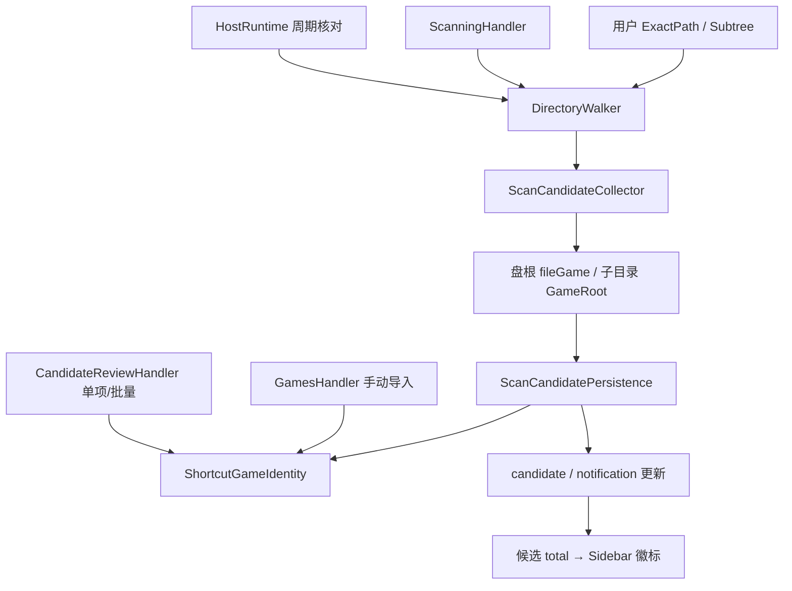

# v1.8.1 扫描边界与快捷方式身份

基线：`aefdb9508295568e7500ba2e4fa8d0630a5ef07e`；计划 `SCAN-181-r1`。

## 共享路径上的修复

- `ScanRuleSet` 只对用户 ExactPath 排除设置 `ExcludeDescendants=false`；Walker 在首次及续扫入口求值，跳过该目录识别但继续后代。Subtree、强制系统边界、链接与遍历预算保持原有约束。
- `ScanCandidateCollector` 将盘根直属入口生成为 `fileGame`，保留引擎/逐入口证据；盘根不再成为 GameRoot / Flash 递归资源边界。普通安装根和 Flash 目录审核仍保留原有剪枝。
- `ScanCandidatePersistence` 仅将本轮实际读取的盘根上、未绑定游戏的 pendingReview 旧候选转为 deferred，保留 payload/ID；事务提交后发布候选与通知更新。已接受、已绑定及用户忽略/暂缓状态不变。
- `GenericGameCandidateDetector` 不再自动发现 LNK。`ShortcutGameIdentity` 每次落库预加载快捷方式入口索引，供扫描、手动导入和候选接受共用。相同规范化文件入口或经唯一 Unreal 打包结构验证的 wrapper/Shipping 关系才能阻止重复；同名/同祖先不能作为合并依据，歧义保留审核。无 schema 或 IPC 变化。
- Sidebar 使用 candidates.list 的 total，不与同一批的通知数量相加。

## 图谱与验证

2026-10-30 调用 code-review-graph 修改前影响上下文；本隔离工作区最终在源码 `687bb4d` 重建 `minimal` 图谱：433 文件、4,343 节点、42,636 边，解析错误为空，构建时 HEAD 与图谱基线一致；未计算云端 embedding。

已运行且通过：83 项专项集成回归（Walker/扫描/候选/Flash/手动导入/MCP null）、36 项规则与引擎检测单元回归、3 项 Sidebar 回归、前端 typecheck。新增手动导入顺序用例修改后再次执行，2 项通过。初轮曾因新增夹具漏填必填时间字段和错误预设 UpsertCandidate 绑定 gameId 失败，已改用真实接受流程修正；前端断言曾错误假设 accessible name 含空格，已匹配真实 DOM。

补充注册范围、审核及目录边界回归后，分轮去重 135 项 .NET（99 集成、36 单元）通过，Sidebar 3 项及 typecheck 通过。按用户后续要求由 Codex 完成最终复核，未将中断的 Go 审查记为通过；本地一致性备份后仅移出 1 张已证实的重复快捷方式卡，保留原文件和历史元数据。详细失败轮次、验证与集成边界见[实施记录](../development/v1.8.1-scan-boundaries-validation.md)。未运行真实游戏、付费翻译 API、全量测试、安装/升级验收；未打包、推送、发布或修改版本字段。
