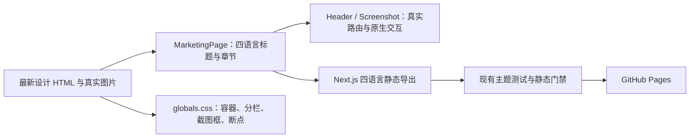
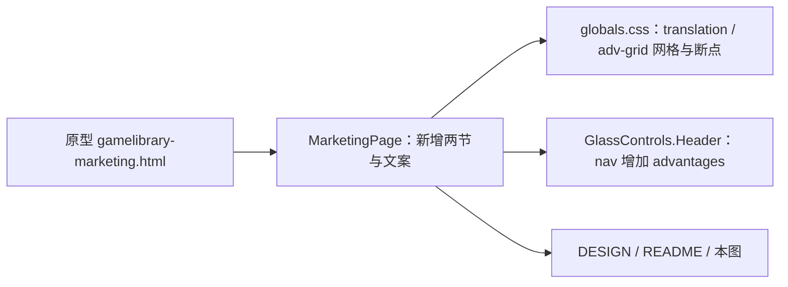
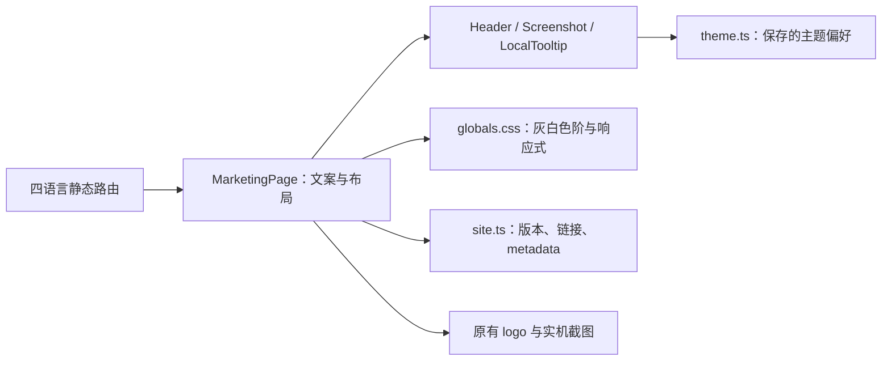
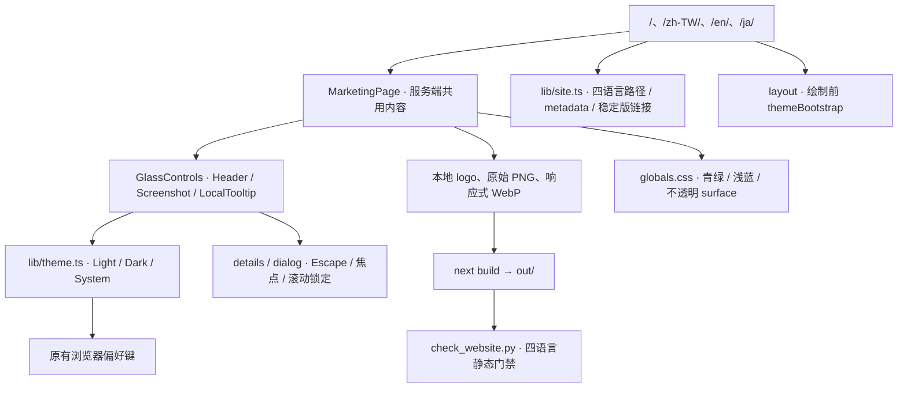

# 最新设计迁入 · 2026-10-13 · 网站 v1.3.0

用户要求将设计项目 `333cacd6-dd27-42fb-86aa-087d19e0d3ec` 作为最新版网页上传 GitHub。来源文件：`C:\Users\sumingwang\AppData\Roaming\Open Design\namespaces\release-stable-win\data\projects\333cacd6-dd27-42fb-86aa-087d19e0d3ec\gamelibrary-marketing.html`；SHA-256：`bf6ef2fd669aa2ecf324ea29b4ceb065c337b0a9ea8ace2654ac96e182dd1e3c`。导出包含完整单页和七项图片资源；逐字节核对与网站现有图片一致，无需替换或生成素材。

审计基线：`6682e85d39b6839ce062b935a160eccd7b159f7d`。布局迁入现有 Next.js 组件，未嵌入整份 HTML 或新增依赖。`globals.css` 改为含侧边距的 1200px 容器、72px 最大主标题、自然换行灰白章节标题、两列优势列表、整理区文字与图片 1.15:0.85 分栏、章节底色和 920px 单列断点。`MarketingPage` 同步图注与已确认的 v1.7.13 验收状态；`Header` 导航对应设计四项，手机隐藏品牌文字但保留可访问名称；`Screenshot` 更新响应式 sizes，保留原始 PNG 弹窗、键盘与焦点逻辑。四语言、metadata、下载文件名与原有发布门禁保留。网站 package / lock 升至 1.3.0，桌面程序不变。

修改前图谱同步成功；修改后增量重解析 3 个文件，更新 25 节点、392 条边，解析错误 0。依赖包含四语言 page / layout，以上为增量更新数，不是全仓总数。回滚可 revert 本次网站提交，不涉及数据库或游戏文件。

本地生产构建、类型检查、既有两项主题测试、静态门禁与负例自检均 passed。网站提交 `8e91c79` 已推送；[Pages 发布流程](https://github.com/sumingwang233/GameLibrary/actions/runs/38357240004)检查 21 秒、部署 10 秒，均 success。线上四语言页面、样式和三项主图片资源均 HTTP 200，线上样式与本地产物逐字节一致。浏览器视觉及响应式人工验收 not-run，不沿用历史部署结果。

以下为历史记录。

# 网站宣传内容同步 · 2026-10-13

将本任务原型 `gamelibrary-marketing.html` 的宣传内容移植进仓库 Next.js 站点，仅改宣传站源码与文档，不动桌面程序、路由、依赖或状态。修改前 `code-review-graph detect-changes` 与修改后 `update --brief` 均报告：6 / 5 个变更文件、2 个变更函数（`MarketingPage`、`Header`）、0 条受影响 flow、2 项无覆盖测试缺口、风险 0.40；`MarketingPage` 与 `Header` 为优先复核入口，两者都是 JSX 内部符号，静态测试缺口不能替代构建、门禁与浏览器验收。

文件范围：`MarketingPage.tsx` 新增 `#advantages`（四卡：数据留本机、原文件不动、入库前人工确认、识别主流引擎）与 `#translation`（库中 Unity 游戏中文翻译：离线固定版本加载器与插件、Mono / IL2CPP 分别处理、补中文字体、先备份可回滚、翻译密钥只存本机），四语言且含 `aria-labelledby`；hero facts 移除 MIT 链接、改为「离线可用 / Works offline」，保留一处 `LocalTooltip`；FAQ、collection、launch、safety、download 文案同步 v1.7.13（标签拖放归类、Flash 合集建议启动方式、默认目录 `%LOCALAPPDATA%\GameLibrary`、下载区仅留发布说明链接）。`globals.css` 将 `.translation` 并入既有网格选择器（含断点）并新增 `.advantages` / `.adv-grid`。`GlassControls.tsx` 的 `Header` nav 增加「独特优势」。翻译功能描述依据 [unity-translation-backend.md](../unity-translation-backend.md)（XUnity.AutoTranslator + DeepSeekTranslate，Mono / IL2CPP 按 PE 位数分别处理，本机 DPAPI 保存密钥）。

回滚：revert 本次 commit，恢复原首屏 facts，并移除新增两节及其样式与导航项；桌面游戏库、数据库与游戏文件不受影响。

| 本次执行 | 结果 |
|---|---|
| `npm --prefix website run typecheck` | passed |
| `npm --prefix website test` | passed；既有 2 项主题测试 |
| `npm --prefix website run build` | passed；Next.js 16.3.7 成功导出四语言 |
| `check_website.py --self-test` / `check_website.py` | passed |
| `website/out/index.html` 内容核对 | passed；含 `id="advantages"`、`id="translation"` 及新增文案 |
| 浏览器响应式与视觉验收 | not-run；不沿用历史结果 |
| GitHub 推送与 Pages 部署 | 推送见本次 commit；部署 not-run |

以下为历史网站记录。

# 网站下载版本同步 · 2026-10-13

维护者确认 v1.7.13 真机验收并授权正式发布。修改前查询图谱：2 个网站源码文件，影响 7 文件 / 18 节点，风险 medium。复用 `site.ts` 的 `stableVersion` 和现有四语言翻译函数，同步下载文件名、正式版文案、真实验收状态及版本说明链接；四语言 README 同步。无新增路由、状态、依赖或桌面源码变更，真实截图版本仍为 v1.5.5。修改后同步图谱；本次未执行网站测试、构建或 Pages 部署。发布与检查范围见 [v1.7.13 发行记录](../releases/v1.7.13-validation.md)。

以下为历史网站交付记录。

# 网站 v1.2.0 · 2026-10-10

本次基线 `5682ed5`。用户将视觉参考改为 [Agent.Space](https://agent.space/)，要求重构布局并减少文案中的空泛宣传。已读取其首页 HTML 与实际样式：深色背景、灰白两级大标题、居中首屏、胶囊按钮、章节留白、简洁导航。浏览器截图接口超时，因此不声称完成了参考站画面比对。

当前站点为 Next.js 静态站，四语言共用 `MarketingPage`，客户端状态集中在 `GlassControls`。现有网站版本 1.1.0；下载源为 v1.7.5，保留维护者验收豁免说明；两张真实截图仍来自 v1.5.5。主要问题是首屏图文较小、功能区重复双卡片、正文多次出现没有具体用途的收藏口号。

文件范围：`MarketingPage.tsx` 重排内容并同步四语言；`globals.css` 替换视觉样式；`GlassControls.tsx` 调整导航标签与截图 sizes；`theme.ts`、三份 layout 与既有主题用例同步默认深色；`site.ts` 更新搜索摘要；网站 package/lock 小版本 1.2.0；README、DESIGN 与本图同步。复用现有组件、原生 details/dialog 和主题存储键，不改路由或增加状态管理、依赖、产品版本。

迁移顺序：读取现有实现和参考站 → 图谱影响审计 → 重排页面与四语言文案 → 同步样式、主题与 metadata → 更新文档 → 本地 commit。P0 保留真实素材、下载与验收状态；P1 重构排版和文案；P2 响应式与无障碍沿用现有机制。验收目标为四语言内容完整、现有锚点可达、截图保持真实版本、主题与原生浮层行为一致、手机单列可读。实际执行情况在交付时单独登记，不沿用下方历史结果。

回滚方式：revert 本次网站 v1.2.0 commit，恢复 v1.1.0 布局与浅色默认；保存的主题偏好仍兼容，桌面程序、数据库和游戏文件不受影响。

修改前已调用 code-review-graph 增量构建及五个核心文件的 focused review：风险 medium，影响 7 个文件 / 13 个节点。图谱结果是静态影响线索，不代表运行验收。

修改后增量解析覆盖 14 个修改文件，更新 88 个节点 / 664 条边，解析错误为空。该计数是本次增量更新量，不是全仓库节点总数。

收尾 focused review 覆盖七个页面、控件及主题文件，风险 medium，影响 4 个文件 / 7 个节点。状态仍限于原有菜单、主题和查看器；没有新增业务流程。

| 本次执行 | 结果 |
|---|---|
| 既有主题测试 | passed，2 项；覆盖默认深色、保存的浅色/深色、跟随系统、无效值及存储不可用 |
| TypeScript 类型检查 | passed |
| 生产构建 | passed；本地 Next.js 成功导出四语言，GitHub Actions 构建也通过 |
| 静态门禁与负例自检 | passed；由现有 GitHub Actions Website 流程执行 |
| 本地静态预览 | running；`http://127.0.0.1:4174/GameLibrary/`，四语言、logo 和两张 WebP 返回 HTTP 200 |
| 本地网页浏览器、响应式与视觉验收 | not-run；没有沿用历史浏览器结果 |
| GitHub 同步与 Pages 部署 | passed；网页源码 `04c6ac3` 已推送，手动发布流程成功 |
| 线上页面与样式 | passed；四语言页面 HTTP 200，新版标题、默认深色及新样式已核对 |
| 桌面构建或产品发布 | not-run；本次仅发布宣传网站 |

后续执行依据：用户明确要求将网页同步 GitHub 并构建运行，随后确认“同时发布线上官网”。推送触发的 [Website 检查](https://github.com/sumingwang233/GameLibrary/actions/runs/38014209124)成功；带 `publish=true` 的[手动发布](https://github.com/sumingwang233/GameLibrary/actions/runs/38014369936)完成 check 与 deploy 两个 job。[线上官网](https://sumingwang233.github.io/GameLibrary/)已返回本次四语言正文；未更改 workflow 的独立部署授权条件。

本地使用 Python 标准库提供生产静态文件，`artifacts/website-preview/GameLibrary` 是指向 `website/out` 的目录联接，保留正式路径前缀。仅绑定 127.0.0.1，不修改系统设置，不提交构建产物、示例原型或其他未跟踪文件。

Node 执行主题测试时报告既有 TypeScript 文件的模块类型推断警告；两项用例均通过，未为消除提示扩展 package 模块配置。真实 logo、PNG 和图像生成脚本未变更。

---

以下为 v1.1.0 历史记录，其中版本、发布状态和验证结果仅适用于 2026-10-02。

# 宣传页重构 — 网站 v1.1.0

日期：2026-10-02。源码输入基线 `7d6c119`。本次仅改宣传站与对应门禁/文档，产品仍为 1.7.3；没有推送、部署、打包或创建 Release。

## 审计与事实

- [package.json](../../website/package.json)、[next.config.mjs](../../website/next.config.mjs)：独立 Next.js 16.3.7 / React 19.2.4 / Tailwind 4 静态站，正式前缀 `/GameLibrary`，已有中英两语言。
- [原有页面](../../website/components/MarketingPage.tsx)、[控件](../../website/components/GlassControls.tsx)：共用页面，原生语言/主题菜单、截图 dialog、手机导航 dialog；无需路由库或全局状态库。
- 用户提供的 `FrontEnd_Design/gamelibrary_1/code.html`、`gamelibrary_2/code.html` 与 `screen.png` 是原型输入。它们引用占位截图、远程 logo；部署代码不能直接复制这些素材链接。
- 真实素材为 `website/public/assets/icon.png`、`library.png`、`tags.png`。主 README 确认截图来自 v1.5.5 简体中文隔离示例库，1320×820、默认封面，无个人游戏路径。用户进一步确认所需图标是 GameLibrary 应用 logo。
- [发布原则](../release-policy.md) 与[公开稳定版](https://github.com/sumingwang233/GameLibrary/releases/tag/v1.5.5)：主下载仍为 v1.5.5，v1.7.3 属于待验收预发布。

原有技术债：深色渐变/玻璃与新原型不一致；页面只支持中英；首屏文字和大图分开，主下载与便携/工具三卡同权重；门禁强制旧玻璃样式。原型“五星评分”也不能直接宣称为游戏评分：真实截图显示该星级是标签排序。

## 架构与运行图

静态路径和版本由 `lib/site.ts` 共享，繁中/日文用新增动态段的 `generateStaticParams` 固定导出；未知 locale 在页面和布局边界返回 notFound。保留既有 `/`、`/en/` 路由及锚点，新增 `#launch`、`#preview`。状态只包含主题、菜单、截图窗口及图片失败状态。

## 文件与迁移

| 文件 | 实际变化 |
|---|---|
| `website/components/MarketingPage.tsx` | 按原型重排首屏、扫描、分类、启动、隐私、下载、FAQ；接入两张真实截图；修正星级文案；四语言共用内容；稳定版主按钮与独立预发布入口 |
| `website/components/GlassControls.tsx` | 导航与浮层四语言；40px 真实 logo；复用已有 details/dialog；截图失败说明与响应式 sizes |
| `website/app/globals.css`、`website/lib/glass.ts` | 移除光球、渐变和玻璃模糊；加入浅蓝/青绿 tokens、平面 surface 和手机断点；保留旧文件/调用名避免无意义迁移 |
| `website/lib/theme.ts`、原有两份 layout | 新用户浅色；保留显式 Light / Dark / System 选择；同步首次绘制与 theme-color |
| `website/lib/site.ts`、`website/app/(localized)/[locale]/{page,layout}.tsx` | 四语言选择、路径、metadata、静态参数和 locale 检查；不增加客户端路由状态 |
| `website/public/sitemap.xml`、`scripts/check_website.py` | 四语言 canonical/hreflang、锚点、素材、下载一致性、静态前缀与减弱动画检查；禁止远程占位图片 |
| `website/scripts/theme.test.mjs` | 既有主题测试改为验证默认浅色，以及显式 System 两种系统偏好 |
| `website/package.json`、`package-lock.json` | 网站小版本 1.1.0；依赖版本不变 |
| `website/README.md`、`DESIGN.md`、本目录图文 | 记录素材来源、实际实现、验收结果及尚未执行项目 |

迁移顺序：核对原型和已发布功能 → 接入现有 logo/实机图 → 替换页面及样式 → 更新共享主题与四语言路由 → 同步 metadata/门禁 → 构建、浏览器检查 → 本地 commit。重复职责沿用 Header、Screenshot、LocalTooltip；页面没有额外的通用区块框架。

回滚：revert 本次网站 v1.1.0 实现 commit，恢复原 CSS、主题默认、两语言页面和门禁，移除新增 locale 路由；原始图片和主题存储键保持兼容。回滚不触碰桌面游戏库、数据库或游戏文件。

## 验收证据

| 检查 | 结果 |
|---|---|
| `npm --prefix website run build` | passed；四个页面成功静态导出 |
| `npm --prefix website run typecheck` | passed |
| `npm --prefix website test` | passed；2 项原生 Node 主题测试 |
| `check_website.py --self-test` | passed；坏锚点、缺图/尺寸、路径前缀、无名 dialog、远程占位图、缺少减弱动画规则等负例 |
| `check_website.py` | passed；四语言、链接、图片、metadata、sitemap |
| 四语言 × 320/375/768/1440px | passed；无横向页面溢出，无已加载图片损坏 |
| `/GameLibrary/` 四语言正式导出预览 | passed；图片与前缀链接正常，canonical 正确，浏览器错误日志为空 |
| 查看器与菜单 | passed；放大、Escape、关闭后恢复焦点、滚动锁定、手机导航、键盘语言选择 |
| FAQ 与主题 | passed；键盘展开；深浅切换与刷新持久化；减弱动画时 scroll-behavior=auto |
| 414px、200% 缩放、无脚本、图片故障注入、语言人工审校、Lighthouse | not-run；不沿用旧版测试结果 |
| 线上部署、桌面构建和产品发布 | not-run；本次范围为本地网页重构 |

本机 `python` 命令解析到 WindowsApps 执行别名并返回 1，无有效解释器输出；门禁使用 Codex 提供的现有 Python 完整路径执行，没有修改 PATH 或用户环境变量。构建首次遇到新增 Next.js 路由的参数类型限制，已将参数改为 string 并在边界核对 locale，随后构建通过。

视觉证据保存在未跟踪的 `artifacts/website-prototype-v1.1.0/desktop-full.jpg`、`desktop-hero.jpg`、`mobile-full.jpg`，来自本地正式静态导出。原型的两处占位图均已替换；扫描示意明确标识，不生成冒充实机的审核/启动 UI。

## 图谱与优先级

修改前调用 code-review-graph 增量构建，发现原数据库节点统计为空；随后 full build 成功解析 362 个文件，生成 3,500 节点、30,508 边，错误 0。收尾增量刷新后，list_graph_stats 返回 361 个 File 节点、3,444 节点、29,893 边，错误仍为 0；这些为对应调用的实际统计。最小变更审查覆盖 13 个跟踪文件，24 个变更函数/类；`validate`、`Screenshot`、`FeatureIcon` 为优先复核入口。其 20 项静态测试缺口包含 JSX 内部符号与浏览器交互，不能替代实际构建、门禁及浏览器验收。五个核心文件的最终 focused review 为 medium，影响 7 个文件 / 13 个节点；已人工复核语言/路径、主题默认与原生浮层调用。

P0 素材与下载真实性已完成；P1 原型布局、主题与四语言已完成；P2 本地响应式和交互已完成。下一步按需要补充对应稳定版审核/启动实录、语言人工审校和发布授权；未授权前不推送、不部署。

