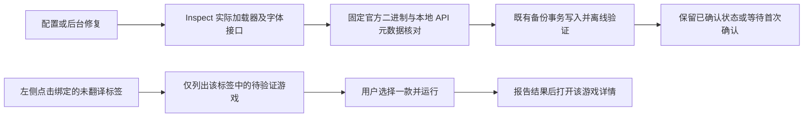

# v1.7.12 Unity 翻译兼容与按需验证

2026-10-11。沿现有 `UnityTranslationService`、本机凭据库和文件事务修复，不新增加载器、数据库表或第三方依赖。

## 审计事实

- 两个 Mono 样例日志均为 BepInEx 6 build 738、`0 plugins to load`；翻译入口来自官方 XUnity Mono BepInEx 5.4.5 包，基类引用 `BepInEx.BaseUnityPlugin`。旧检查只确认程序集名称，没有核对加载器基类契约；禁用重复 Rei 入口后也没有可加载的翻译入口。
- Unity 6 样例中，TMP 字库加载报 `AssetBundle.LoadFromFile_Internal` unstripping 失败；UGUI 字体工厂的单字符串重载错误使用 `Il2CppReferenceArray<System.String>`，引发约束异常。实际生成程序集另有有效 `Il2CppStringArray` 重载和公开静态 TMP 系统字体接口。
- 前端原来轮询到 configured 状态就弹窗，关闭后自动挑下一个。后台修复又把 confirmed 改成 configured，造成升级后重复验证。

上游证据：[Mono BepInEx 6 兼容问题](https://github.com/bbepis/XUnity.AutoTranslator/issues/674)、[XUnity 版本说明](https://github.com/bbepis/XUnity.AutoTranslator/blob/master/CHANGELOG.md)、[Unity 6 字库接口问题](https://github.com/bbepis/XUnity.AutoTranslator/issues/716)、[Unity 字体接口定义](https://github.com/Unity-Technologies/UnityCsReference/blob/master/Modules/TextRendering/TextRendering.bindings.cs)、[官方 BepInEx 构建](https://builds.bepinex.dev/projects/bepinex_be)。这里只确认离线兼容原因，实际游戏翻译与显示仍需运行验收。

## 流程与文件

1. `UnityTranslationCompatibility.cs`：只升级能逐文件核对官方 5.4.5/5.6.2 的 Mono XUnity 组件至固定 5.6.2；用已有固定 Cecil 重定向两处插件基类和 BepInEx 引用，并逐项解析实际 BepInEx 6 API。保留加载器与其他 MOD；未知组件拒绝覆盖。
2. `UnityTranslationAssembly.cs`、`UnityTranslationFonts.cs`：固定 IL2CPP 核心的 Unity 6 字体工厂改用有效数组重载；已生成且可用的 TMP 系统字体 API 优先于外部 AssetBundle。保留用户自定义字体，不修改游戏原始资源或安装系统字体。恢复后保留 interop 的安装会在加载器写入后、同一事务内完成补丁。
3. `UnityTranslationPayload.cs`、`UnityTranslationInspection.cs`：离线解析包含实际加载器目录；两个 Mono 插件都需继承正确的 BepInEx 6 基类，不能只靠文件存在判断成功。
4. `UnityTranslationService.cs`：后台修复持久保留确认依据，显式重配仍产生新尝试；status 返回当前绑定标签的 `tagged` 布尔值。`PreserveConfirmation` 是既有 app_settings 状态的兼容可选字段，无 DDL。
5. `App.tsx`、`Sidebar.tsx`、`UnityTranslationDialog.tsx`：标签点击触发一次验证列表；普通启动、轮询、详情重试不会自动弹验证。一次确认后导航该游戏详情，不串行弹下一款。沿用现有 Sheet、确认框和导航，没有新路由或状态管理库。
6. `UnityTranslationTransaction.cs`：同一文件先安装再兼容修补时，回滚预检核对该文件最后一次写入，再按倒序还原。防止后续验证失败时把本次较早的合法写入误判为外部改动。

## 迁移、回退与验收

- 版本真源和 npm/Cargo 产品条目统一为 1.7.12；四语言补充空列表文案。
- 首次 IL2CPP 安装尚未生成 interop 时保留既有路径；生成受支持 API 后再次配置或后台修复可迁移字体方案。拒绝/未知组件仍需用户从详情显式重试。
- 已有 confirmed 在后台修复成功和重启后保持 confirmed；不会根据“进程运行过”猜测旧版已丢失的用户确认结果。用户显式重配仍需实际验证。
- 使用详情中的“恢复安装前状态”回退本次文件事务；恢复原翻译文件和 Rei 调用，保留加载器、未知 MOD、游戏原始资源与元数据。
- 优先验收两个 Mono 样例是否加载翻译、Unity 6 是否显示简体中文完整字体；再验收启动无弹窗、标签按需列表、确认回详情及升级保留确认。离线回归不能替代这些人工验收。

实际执行结果和待验收项见 [专项验证](v1.7.12-validation.md)。
