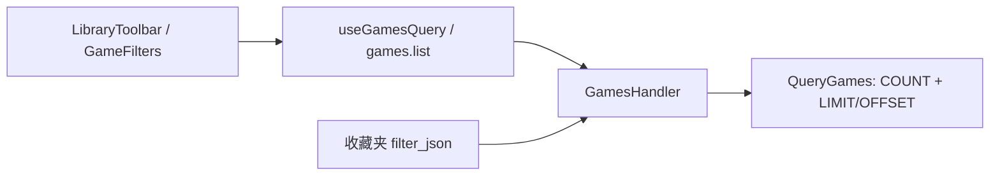

# v1.7.15 封面筛选

2026-10-16，基于 `43ca978`。用户授权本次封面筛选专项回归及必要编译。

游戏列表工具栏增加“不限封面 / 有封面 / 无封面”，可叠加搜索、收藏、标签和排序。切换条件重置分页；封面新增、选择和重置沿现有资产事件刷新结果。

`hasCover` 使用可空布尔契约：`true` 有当前封面，`false` 无当前封面，缺省或 `null` 不限封面。数据库依据 `game_assets.is_current`，与卡片 `coverAssetId` 一致；重置后仅保留历史封面的游戏归入“无封面”。列表查询不逐游戏探测磁盘文件是否损坏或离线。

修改沿既有组件、查询及收藏夹存储完成，没有新增依赖、路由或数据库迁移：

- `LibraryToolbar.tsx`、`App.tsx`、`state.ts`、`types.ts`、`useGamesQuery.ts`：控件、三态、查询身份与收藏夹保存/恢复。
- `GamesHandler.cs`、`LibraryCatalogStore.Games.cs`、`SqliteLibraryStore.Games.cs`：共同 WHERE 同时约束分页前总数和结果。
- `LibraryViewStore.cs`、`SqliteLibraryStore.ViewSettings.cs`、`ViewSettingsHandler.cs`：复用 `filter_json`；历史视图缺省为不限封面，更新未提供字段保持原值，显式 `null` 清除。
- `IpcRequests.cs`：复用布尔读取并校验可选字段，拒绝字符串、数字等错误类型。
- `operations.v1.json` 及生成文件、CLI、MCP：同一查询参数。CLI 提供 `--with-cover`、`--without-cover`、`--all-covers`；MCP 更新区分未提供与显式 `null`。
- `ui.json`：简体中文、繁體中文、English、日本語；版本真源及 npm/Cargo 锁文件同步为 1.7.15。

真实验证结果：

| 检查 | 结果 |
|---|---|
| Integration：`CoverFilterTests / ViewsTests / GameCoverTests` | 31/31 通过 |
| Contract：`OperationSchemaParityTests` | 22/22 通过 |
| 前端：`LibraryToolbar.test.tsx / hooks.test.ts` | 16/16 通过 |
| `npm run build`（TypeScript + Vite） | 通过；保留现有大于 500 kB 的 chunk 提示 |
| `check_localization.py` | 688 条 UI、43 条安装器四语言通过 |
| `generate_operations.py --check`、`git diff --check` | 通过 |

覆盖真假参数、分页/总数、搜索/收藏叠加、移出库游戏、历史封面重置、重新选择封面、收藏夹保存与完整快照覆盖、缺省保持/显式清除、非法类型，以及工具栏三种选项。首次契约编译发现原有 `Envelope` 命名空间引用错误并修正；新断言也已兼容没有必填参数时省略 `required` 的实际 schema，复跑后通过。

证据：`artifacts/local/v1.7.15-tests/cover-filter.trx`、`cover-contract.trx`。全量测试、运行中桌面和真实游戏库人工验收未执行。本次未打包、推送或发布。

回滚：撤销本次提交即可恢复旧行为；无数据库迁移，旧版本可忽略收藏夹 JSON 中的新增条件。人工验收可在工具栏依次选择三种条件、翻页，并在导入/重置封面后确认结果移动和总数更新。
