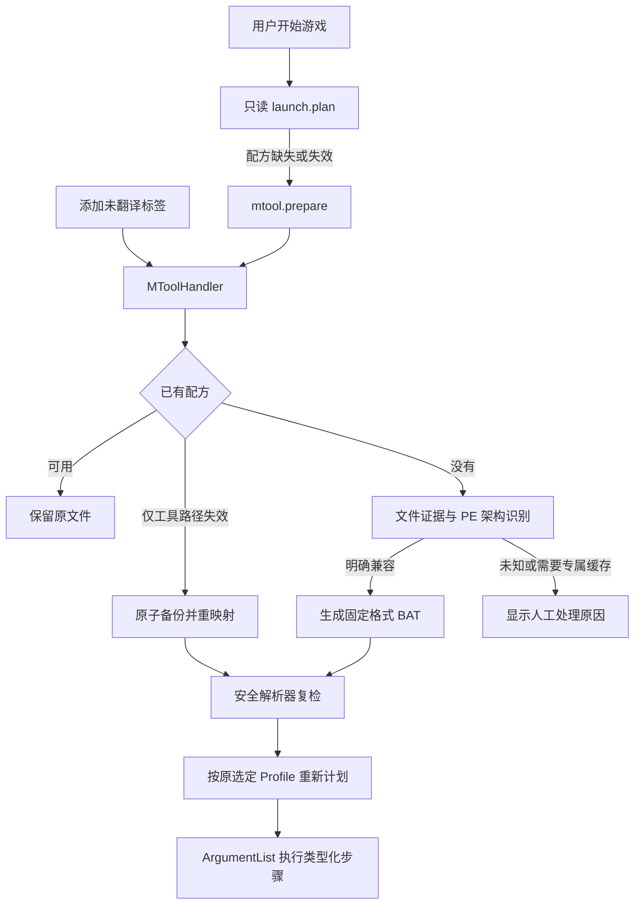

# v1.7.17 MTool 配方自动生成

## 审计与依据

原实现由 `MToolAdapter.Discover` 只读解析游戏目录中的 `与工具一同启动.bat`，`TranslationLaunchRouteResolver` 提取固定进程步骤。标签回调只接入 Unity，因此非 Unity 游戏不会产生缺失配方；重映射工具路径的接口也未接入生产流程。

[MTool 作者的官方论坛说明](https://bbs.mtool.app/topic/850/mtool启动命令是否有参数/3)指出，游戏路径/`--dp=` 命令行启动依赖引擎检测成功，注入器与工具主体分开。[官方教程](https://mtool.app/tutorial.php?lang=chs)要求在 MTool 选择游戏、启动后再选择翻译。未找到稳定的“只生成、不启动”公开接口；不能把传入游戏路径的命令当作安全的后台配置接口。

本地只读检查了现有生成脚本、公开加载器文件名及 EXE 版本元数据，没有读取 MTool 凭据配置，没有执行 MTool 或真实游戏。现有配方包含普通注入、Bakin 包装和专属缓存入口三类。缓存转换不能用原游戏 EXE 替代。

## 流程与文件职责

- `MToolRecipeGenerator`：保留可用配方；修复仅映射工具程序、hook 和工具目录，游戏/缓存入口保持原值；缺失游戏或缓存时停止。新生成只支持有明确证据的 RPG Maker MV/MZ、SRPG Studio、Pixel Game Maker MV、RPG Developer Bakin。MV/MZ 需 core JS、System.json、nw.dll 和匹配 PE 位数；其他类型使用现场确认过的版本资源特征。注入式 hook 还需匹配游戏 PE 架构。不会依据文件夹名称、模糊 engine 字符串猜 DLL。
- `MToolHandler`：复用 dispatcher 的变更串行门和库会话租约，同步完成有界文件操作，不新增后台轮询。添加标签时尝试，启动时补齐；复用推荐 Profile，尚无 Profile 时可使用已确认的 `EntryPath`。显式 `NotRequired`、Unity、外部工具绑定分别跳过。标签绑定复用已有 Unity 标签设置，元数据键值放入现有 `app_settings`，无 schema 迁移。
- `LaunchingHandler`/`TranslationLaunchRouteResolver`：未翻译标签参与有效翻译需求计算，仍由 `NotRequired` 显式覆盖。`launch.plan` 始终只读；桌面通过 `mtool.prepare` 后对同一 Profile 重试计划，`launch.execute` 的共享后端另有兜底，CLI/MCP 同样受益。复用 `LaunchRegistry.ResolveExecutionPlan` 先检查计划修订与实际目标，过期计划不写配方，同时传计划与另一个 Profile 时严格跟随执行器的计划优先级。失败保留恢复指引并禁止原文直启。
- `MToolTranslation.tsx`：设置页可选择 MTool 安装目录；只有一个有效的正在运行安装时可以自动发现。详情页显示最近生成结果、具体失败原因、脚本和备份路径，并提供重试。复用事件流刷新，不弹出运行验证队列。
- `contracts/operations.v1.json`：登记 `mtool.settings.get/set`、`mtool.status`、`mtool.prepare`；CLI/MCP、输入 schema 由既有生成器同步。CLI 路径使用 `mtool settings-set --path <目录>`。

## 迁移、边界与恢复

优先级为：可用旧配方 → 工具路径修复 → 明确引擎的新配方 → 人工处理。原子替换时保存唯一 `.bak`，写前复查原摘要；创建新文件不覆盖同时出现的用户文件。生成路径拒绝 BAT 元字符、符号链接和目录联接，脚本解析限定 64 Ki 字符。工具选择路径仅写本地库，不包含密钥，不读取或上传工具账户配置。

生成配方不代表翻译效果已验证，不移除未翻译标签。需要 MTool 专属缓存的 Wolf/Ren'Py/Kirikiri 等复杂情况，如果已有完整配方则继续使用；缓存缺失或没有可确认模板时提示在 MTool 中重新选择游戏。未实现新的引擎缓存转换或不确定的加载器安装。

可通过 `.bak` 恢复旧 BAT；新生成 BAT 可由用户移除后重新生成。源码回滚不需要回滚数据库 schema，额外 `mtool.*` 元数据不会影响旧版读取。

## 验证记录（2026-10-16）

用户明确授权隔离专项回归及必要编译；使用隔离游戏、工具目录和 `GameLibrary.TestProcessStub`，没有启动真实游戏，没有请求翻译 API。

| 验证 | 结果 |
|---|---|
| Integration：MToolPreparationTests / MToolDiscoveryTests / TranslationConfigTests / TranslationStepTimeoutTests / LaunchOperationTests | 57/57 通过 |
| Unit：BatRecipeParserTests | 27/27 通过 |
| Contract：OperationCatalogTests / OperationSchemaParityTests | 28/28 通过 |
| 前端：mtool / MToolTranslation / DetailSheet | 33/33 通过 |
| Host 及测试引用 CLI/MCP 等编译、前端 typecheck | 通过 |
| 操作生成器 | 112 个可用操作、3 份生成文件同步 |
| 四语言检查 | 727 条共享 UI、43 条安装器文案通过 |

覆盖标签生成、显式非必需策略、只读计划、所选入口不变、后端直接执行兜底、过期计划拒绝写文件、计划与 Profile 优先级一致、旧路径原文备份、重复执行不改文件、缺缓存/未知引擎/不支持脚本拒绝、x86 hook、缺 hook、目录边界、大脚本限制和详情异步旧响应隔离。全量测试、真实游戏翻译效果、桌面人工验收未执行；本次未打包、推送或发布。
