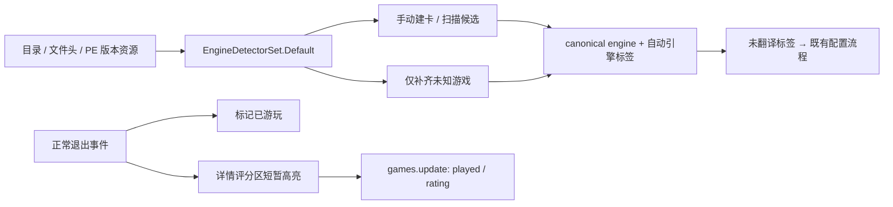

# v1.7.18 游戏状态、评分与引擎识别

## 审计与方案

基线为 `de777c5`。详情页的收藏按钮直接写 `games.favorite`，没有独立的游戏评分或已游玩字段；标签的 `starred` 是标签评分，不能复用为游戏评分。退出游戏已有 `launch.exited → useLibraryEvents → App → DetailSheet` 链路，因此评分提示复用该事件，不增加弹窗队列。

`GamesHandler.GamesCreate` 原来只保存路径、标题和入口，没有调用检测器，也没有建立自动引擎标签。详情页按真实 `engine == unity` 显示翻译区，所以手动加一个名为 unity 的标签不能补上引擎事实。这是手动游戏缺少翻译选项的根因，不能靠放宽 UI 的标签判断修复。

扫描、入口建议和目录检查原来各自注册五个检测器；MTool 配方生成又独立读取部分 EXE 版本资源。新增规则统一进入 `EngineDetectorSet.Default`，扫描、手动添加、入口建议、只读检查和 MTool 配方选择共享证据。已存的非空、非 unknown 引擎不会被更新。

## 文件与行为

| 范围 | 改动 |
|---|---|
| `DatabaseMigrations` / `GameCard` / 两层 Games Store | schema 29 增加独立 `played` 与 `rating`，保留 favorite；评分只允许整数 0–5，0 为未评分；列表、详情和单卡读取同源 |
| `GamesHandler` / `GameCatalogService` | 真实文件检测后手动建卡，自动引擎标签与建卡处于同一事务；受限 patch 支持 played/rating，保留 Revision CAS、幂等收据和 favorite |
| `HostRuntime.WireAttemptPersistence` | 已启动且 exitCode=0 的正常退出首次标记已游玩；失败和崩溃不标记，不改评分、收藏或入库时间 |
| `DetailSheet` / `App` | 收藏按钮改为可切换的已游玩；五星按钮可重评、清除；每个新退出事件提示一次，12 秒后停止高亮，遵循 reduced-motion；关闭或切换游戏清理提示 |
| `Sidebar` | 只删除收藏夹分组及相关按钮，保留上方收藏筛选；Tags 复用原有滚动空间 |
| `GameEngineRecognition` / `OperationDispatcher` / `ScanCandidatePersistence` | 启动及既有 metadata tick 每批最多处理 20 个未知游戏；标签赋值立即检查；实际重扫也补齐未知；CAS 不覆盖已知引擎，自动标签尊重 suppress |
| `IDirectorySnapshot` / `FileSystemDirectorySnapshot` | 新增只读、缓存的 PE 版本资源探测；读取前检查路径边界和重解析点，不执行程序 |
| `AdditionalEngineDetector` / 既有检测器 | 补充 RGSS XP/VX/VX Ace、WOLF、SRPG Studio、Pixel Game Maker MV、Bakin、Godot、Unreal、Tyrano；Unity 多 `_Data` 目录优先真正配对的入口；Kirikiri 可使用嵌入发行 EXE 的版本证据 |
| operations catalog / CLI / MCP / 四语言字典 | 同步可选 played/rating；CLI 使用 `--played`、`--unplayed`、`--rating 0..5`；MCP 可选 null 不覆盖状态 |

没有增加路由、全局 UI 状态库或依赖。未知游戏检测一轮后不会每 30 秒反复读取同一批目录；离线样本可在后续扫描、标签赋值或下次会话中重新检查。识别引擎不等于已支持该引擎的自动翻译注入，MTool 的缓存、配方和加载器安全约束继续生效。

## 识别依据与限制

- [MTool 官方引擎清单](https://mtool.app/?lang=chs)作为类别参考，不把 Hook DLL 文件名当成游戏证据；SRPG/AGTK/Bakin 的 PE 版本字段沿用此前本机只读调查确认的实际值，并让配方生成共享该规则。
- RGSS 使用 Game.ini 的 Library 系列与对应脚本/归档配对，区分 XP、VX、VX Ace；现存 `rpgMakerMvMz` 身份不拆分或迁移。参照 [RPG Maker 官方技术教程](https://dl.degica.com/rpgmakerweb/tutorials/RPGMakerVXAceTutorial1.pdf)。
- Godot 使用 [官方 PCK 头定义](https://github.com/godotengine/godot/blob/master/core/io/file_access_pack.h)验证魔数、格式和主版本，或 EXE 的 Godot 版本资源；截断四字节头不会确认。嵌入包且无可识别版本资源的发行版仍保留未知。
- Unreal 要求 Engine 运行时、项目 Binaries 中有效入口以及 Content/Paks 的资源文件组合，拒绝仅空目录；参考 [Epic 官方打包说明](https://dev.epicgames.com/documentation/en-us/unreal-engine/packaging-your-project)。
- Tyrano 使用 [官方源码中的 Config.tjs](https://github.com/ShikemokuMK/tyranoscript/blob/master/data/system/Config.tjs)、tyrano.js 和 index.html 配对，覆盖根目录与 NW.js 的 www 布局。

目录名称、单独 Game.exe、单独 Game.ini、工具目录或不可读/冲突证据不会自动转为某个引擎。没有宣称覆盖 MTool 的全部专有识别规则。

## 迁移、恢复与验收

schema 29 走既有一致快照和事务迁移。历史正常退出记录可回填 played；旧收藏不转成已游玩，历史评分缺省为 0。迁移不改 accepted_utc。原历史 schema 夹具仍可通过版本化读取验证；Flash 业务回归升级到当前 schema，并继续验证 v27 的一次性清理 marker 不重跑。

代码回退至不支持 schema 29 的版本时，应从迁移前快照恢复，旧程序会拒绝较新 schema。翻译文件恢复继续走原加密备份；[Mono 端点修复记录](v1.7.18-mono-endpoint-shadowing.md)说明独立的文件回滚边界。

优先级依次为：修复真实引擎生产链与端点解析；保护旧状态和迁移；最后交付详情交互与共享识别规则。隔离专项和必要编译获得用户授权，结果见本节收尾记录。没有操作真实游戏库、启动真实游戏或调用翻译 API；全量和桌面人工验收未执行，本轮未打包或发布。

## 验证记录

2026-10-17：.NET 整合专项 132/132 通过；随后新增真实 CLI 入口/解析/序列化回归，游戏体验专项 8/8 通过（其中 7 项与前述重叠，后端整合独立用例共 133 项）。引擎单元专项 29/29、操作契约专项 6/6、详情/侧栏/事件 Hook 前端专项 45/45 通过，合计 213 个不同专项用例。测试都使用隔离目录、测试管道、合成文件及固定公共插件包，未启动真实游戏或翻译 API。

Host Release 编译 0 警告/0 错误；前端 TypeScript + Vite 生产编译通过，仍有既有的超过 500 kB bundle 提示。112 个 operation 的生成一致性、735 条共享文案和 43 条安装器四语言检查通过。图谱收尾增量同步记录在[图谱索引](../code-review-graph/README.md)。以上不代表全量、安装器或真机验收。
