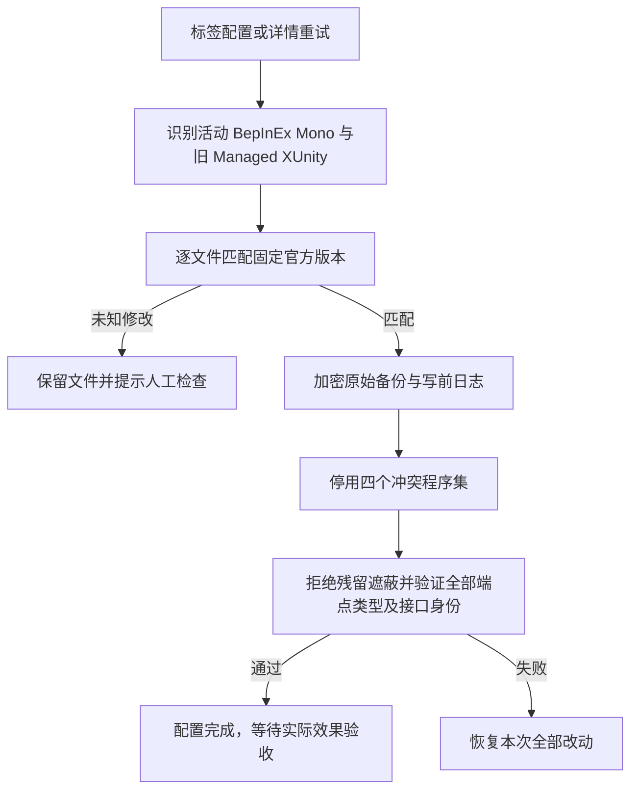

# v1.7.18 Mono 翻译端点加载修复

## 审计与根因

报告日志中，BepInEx 6 Mono 入口成功加载 XUnity 5.6.2，但随后提示找不到 `DeepSeekTranslate`。只读检查确认，端点 DLL 已安装，两个报告样本均同时存在 BepInEx 的 5.6.2 核心和 `*_Data/Managed` 中的 Rei 5.4.5 核心。

[XUnity 5.6.2 的 Settings](https://github.com/bbepis/XUnity.AutoTranslator/blob/v5.6.2/src/XUnity.AutoTranslator.Plugin.Core/Configuration/Settings.cs)从实际已加载核心的 `Assembly.Location` 推导 `Translators` 目录，[TranslationManager](https://github.com/bbepis/XUnity.AutoTranslator/blob/v5.6.2/src/XUnity.AutoTranslator.Plugin.Core/TranslationManager.cs)只在该目录发现端点。BepInEx 入口声明的插件版本不等于 Mono 实际绑定的核心版本。

旧的双加载器协调只撤销 Rei 的启动调用，仍保留默认程序集探测目录中的旧核心。游戏 Mono 优先解析到它，随后扫描旧 `Managed/Translators`，因此看不到安装在 BepInEx 目录中的端点。现有离线检查主动优先搜索新插件目录，并只按接口全名判断，未覆盖真实 Mono 的默认解析路径；自动确认同样只检查正确目录里的端点元数据，因而漏判了冲突。

## 隔离证据

经用户授权，仅复制运行库和加载程序集到隔离目录；没有复制密钥配置、运行游戏主程序或请求翻译 API。使用样本自带 Mono 运行时和仅做反射的独立探针，两个样本均得到相同结果：

| 操作 | 实际绑定核心 | 端点发现 |
|---|---|---|
| 保留原程序集布局 | `Managed` 的 5.4.5 | 端点不在扫描目录 |
| 用生产修复代码备份并停用冲突程序集 | 插件目录的 5.6.2 | 实现正确的端点接口 |
| 用生产恢复代码还原 | `Managed` 的 5.4.5 | 恢复原冲突，证明原始文件准确还原 |

两个样本的四个旧 XUnity 程序集均逐一匹配 SHA-256 固定的官方 ReiPatcher 5.4.5 资源。该实验只证明程序集解析、端点类型识别和文件恢复，不能代替实际游戏画面或在线翻译验收。日志中的 TMP 方法/字体版本警告与“扫描错端点目录”属于不同检查层次，不能把警告当作服务端点缺失的原因。

## 修复流程与职责

- `UnityTranslationCompatibility`：公共检测旧 Mono XUnity 遮蔽；自动修复只接受固定官方资源摘要，拒绝未知版本、修改内容和超过限制的文件。仅处理 XUnity 核心、ExtProtocol、Common 和 ResourceRedirector，不清理通用 Harmony/MonoMod 或其他 MOD。BepInEx 字体升级留在 BepInEx 安装位置，避免再次向 Managed 写入 Rei 核心。
- `UnityTranslationService`：将旧程序集停用和现有插件、配置写入纳入同一备份事务、路径/只读检查、文件摘要复查及取消边界。已适配的 BepInEx 6 入口也必须修复残留，不能被“端点文件存在”提前跳过。
- `UnityTranslationTransaction`：新增可恢复的文件移除，扩展私有备份清单的可选 `Removed` 标记，兼容旧清单。写前记录、加密原文件、失败回滚和跨进程恢复均保留；外部修改后拒绝覆盖。
- `UnityTranslationInspection`/`VerifyEndpointAsync`：存在遮蔽就不认为中文插件已配置；离线检查必须解析端点的全部类型，并对实际接口对象做可赋值性检查，不能仅比较类型全名。

翻译修复本身无新增数据库迁移、IPC 操作、后台定时任务、供应商设置或密钥读取流程；同版追加的游戏状态、评分和引擎识别见[游戏体验实施记录](v1.7.18-game-experience-and-engines.md)。版本真源登记为 1.7.18，同步 npm/Cargo。更新应用后，对受影响游戏使用“配置或重试翻译插件”即可应用同一公共修复，不依赖游戏名称特判。

## 优先级、恢复与验收

先消除已证实的核心遮蔽，再严格检查端点身份，最后进行真实游戏在线翻译和字体画面验收。未知文件必须保留，不以复制第二份端点到错误目录、降级到其他翻译引擎或原文直启掩盖问题。

“恢复安装前状态”会同时恢复原来的旧程序集；再次配置应可重复修复。若文件在安装后被第三方修改，先保留现场并人工处理。翻译模块的源码回滚无需回滚数据库；同版 schema 29 的降级需使用迁移前快照。本次没有修改原游戏目录、安装版应用或真实密钥存储。

## 验证

隔离专项回归与必要编译已获明确授权。翻译加载、事务与字体兼容专项 22/22 通过，并计入同版 132 项整合回归；覆盖已适配 BepInEx 6 入口仍有旧核心、未知旧文件拒绝写入、端点失败时旧文件全部回滚、移除/写入交错及跨实例恢复、原有字体与端点边界。Host Release 编译通过。未执行全量测试、真实游戏启动、在线翻译或桌面人工验收。本次没有打包、推送或发布授权。
