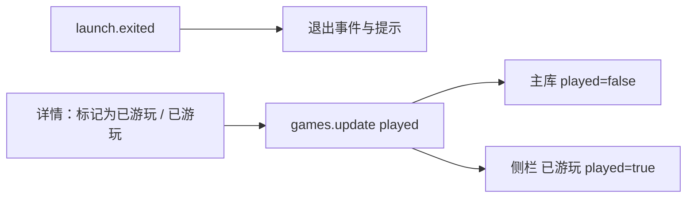

# v1.7.21 已游玩改为纯手动标记

基线：`3d868f1`（v1.7.20 交付记录），2026-10-17。本次为未发布源码，未打包或推送。

## 原因与行为

v1.7.18 在正常退出（`exitCode=0`）时自动把游戏标记为已游玩，v1.7.19 又把它接进了独立“已游玩”库。用户希望“已游玩”表达的是自己判定的通关/全收集，只能由用户在详情页手动决定，而不是启动过就自动分类。

现在 `launch.exited` 只发布退出事件，不再写 `games.played`，也不再因此发布 `game.updated`；成功、失败和崩溃退出都保持原状态。详情页“标记为已游玩/已游玩”按钮仍走 `games.update` 的 `played` 字段，主库与侧栏“已游玩”的筛选、数量和分页沿用 v1.7.19 实现。取消标记后游戏回到主库。

按本轮决策，schema 29 已交付的一次性历史回填保持不变：v1.7.18 以前的成功退出记录在升级时仍会回填一次，已标记数据不清理（历史自动与手动标记无法安全区分），用户可在详情页逐项取消。评分、收藏、标签、入库时间和启动统计不受影响。

## 实现与契约

删除 `HostRuntime.WireAttemptPersistence` 退出分支中的 `MarkGamePlayed` 调用与伴随的 `game.updated` 发布，同时删除因此失去调用方的 `MarkGamePlayed`（`LibraryCatalogStore` 与 `SqliteLibraryStore` 各一处）。`games.update`、`games.list.played`、数据库 schema、本地化文案和前端均不变；没有新依赖、DDL、路由或依赖。

| 文件 | 改动 |
|---|---|
| `src/GameLibrary.Host/HostRuntime.cs` | 退出时不再自动标记，仅发布 `launch.exited` |
| `src/GameLibrary.Infrastructure/Persistence/LibraryCatalogStore.Games.cs`、`SqliteLibraryStore.Games.cs` | 删除无调用方的 `MarkGamePlayed` |
| `tests/GameLibrary.IntegrationTests/Manual/GameExperienceTests.cs` | 成功/失败/未启动退出均断言 `played` 不变，评分、收藏和入库时间保留 |
| 图谱索引、四语言 README 与版本文件 | v1.7.21 同步 |

回滚：还原本次提交即可恢复 v1.7.20 的自动标记；不涉及数据迁移或数据修复。

## 验证记录

- `GameExperienceTests`、`GameExperienceMigrationTests` 共 11 项通过：手动标记往返、筛选与分页、非布尔拒绝、schema 29 迁移回填保持，以及三种退出结果均不改变 `played`、`rating`、`favorite`、`accepted_utc`。
- `GameLibrary.Host` Release 编译通过，0 警告 0 错误。
- 未执行真实桌面点击、真实游戏启动、全量测试、前端构建或安装器验收。
