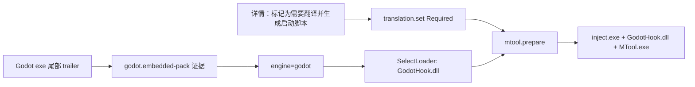

# v1.7.22 Godot 引擎识别与 MTool 翻译规则

基线：`2a70853`（v1.7.21 交付记录），2026-10-17。本次为源码改动，打包记录另附。

## 审计与根因

样本 `F:\水泳少女診察シミュレーション`（Godot 4.6.2.godotbuilder，内嵌 PCK）在旧版无法通过 MTool 启动：

1. Godot 检测只认外部 `.pck` 文件或 PE Product 含 `Godot Engine`。该导出没有 `.pck`，PE 版本串全为空 → `engine=null`。
2. `MToolRecipeGenerator.SelectLoader` 没有 Godot 映射 → 即使识别到 Godot 也只能报"无法确认适用的 MTool 加载器"（本机 `app_settings` 已有同类 blocked 记录）。
3. 游戏没有翻译需求标记；详情页"生成或修复 MTool 启动脚本"在未标记时返回 skipped 且不落状态，界面承诺"点击生成即可"与后端门控不一致。

只读实测证据：

- exe 尾部 12 字节 = `uint64 39196812` + `GDPC`；包头在 `104,567,296`，内容为 `GDPC` + pack format 3 + 版本 4.6.2。
- MTool 手工脚本 `与工具一同启动.bat` 步骤为 `inject.exe <game.exe> GodotHook.dll` + `MTool.exe Tool`，现有解析器可解析、引用文件齐全、不 Broken。
- `loaders/GodotHook.dll` 为 x64（0x8664），与游戏 PE 架构匹配。

## 行为与规则

- 内嵌 PCK 证据：文件尾 `[uint64 包大小][GDPC]`，包头按"包大小 + 12 字节尾部"之前的偏移校验 `GDPC`、pack format 1–4 与 major 2–4。只做两次定长读取，不扫描整个可执行文件；代码段里的 `GDPC` 常量或截断尾部不会误判。
- `EngineId.Godot` → `GodotHook.dll`；沿用注入器双参数、游戏/Hook PE 架构匹配、引用文件存在性与生成后复检，不新增脚本解释器。
- 详情页按钮：翻译策略从未设置且不是显式 `NotRequired` 时，先写 `translation.set(Required, expectedRevision)` 再 `mtool.prepare`；显式 `NotRequired`、Unity 游戏与已有 `未翻译` 标签路径不变。
- 识别生效路径：`GameEngineRecognition.Reconcile` 在 Host 启动和元数据核对时补齐未知引擎（每轮最多 20 个未知游戏），无需重新扫描。
- `IDirectorySnapshot` 新增定长区间读取，默认实现返回 NotFound，不强制历史测试替身实现。

## 文件与兼容边界

| 文件 | 改动 |
|---|---|
| `src/GameLibrary.Domain/Detection/IDirectorySnapshot.cs`、`AdditionalEngineDetector.cs` | 区间读取与 `godot.embedded-pack` 证据 |
| `src/GameLibrary.Infrastructure/Scanning/FileSystemDirectorySnapshot.cs` | 真实文件快照的定长区间读取（沿用 1 MiB 上限与链接检查） |
| `src/GameLibrary.Infrastructure/Tools/MToolRecipeGenerator.cs` | `EngineId.Godot => GodotHook.dll` |
| `src/GameLibrary.Tauri/src/components/MToolTranslation.tsx`、`ui.json` | 未标记翻译时先写 Required，按钮文案四语言同步 |
| `tests/.../AdditionalEngineTests.cs`、`MToolPreparationTests.cs`、`MToolTranslation.test.tsx` | 内嵌 PCK 正反例、Godot 配方与路由、按钮两步流程 |

没有新 DDL、路由或依赖；旧配方、旧引擎识别与其他加载器映射保持原语义。回滚：还原本次提交即可，既有配方文件不受影响。

## 验证记录

- 真实样本只读验证：`EngineDetectorSet` 输出 `Godot/High/godot.embedded-pack`，唯一入口为该 exe，无引擎冲突；`MToolAdapter.Discover` 解析真实手工 BAT 得到 `inject.exe + GodotHook.dll`、`MTool.exe`，`IsBroken=false`。
- Unit `AdditionalEngineTests` 11/11（含内嵌 trailer 正例、format 越界、`GDPC` 常量与截断尾部反例）。
- Integration `MToolPreparationTests` 15/15（含未知引擎的 Godot 游戏从零生成 `GodotHook.dll` 配方并完成 `launch.plan`）。
- 前端 `MToolTranslation.test.tsx` 6/6，typecheck 通过。
- 未执行真实游戏启动与翻译效果确认、全量测试、桌面人工验收；打包与包校验见对应发行记录。
