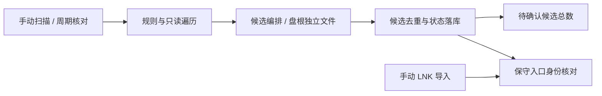

# SCAN-181-r1：漏扫、待确认计数与快捷方式重复入库

用户于当前会话回复“开始执行该计划”，并在恢复 MCP 后回复“继续”。本计划已获执行授权。

## 已确认的目标与边界

- 修复盘根上的单个引擎文件把整盘识别为游戏、阻止后代扫描的问题；独立文件仍可审核入库。
- 恢复 `ExactPath` 只排除自身、`Subtree` 排除子树的语义，不清空用户过滤名单。
- 待确认徽标仅使用候选总数，不叠加同一批候选的通知数。
- 自动扫描忽略 LNK；显式手动导入快捷方式继续支持，并按可验证的实际入口/安装结构防重复。
- 对已证实的重复快捷方式记录，仅从库中移出；保留原文件和历史元数据，不合并评分、时长等历史。
- 无 schema / IPC 扩展。作为 v1.8.1 独立补丁交给既有版本负责人集成，不改其他工作区的版本字段与 Bridge 优化。

## 依据与实现

基线 `aefdb9508295568e7500ba2e4fa8d0630a5ef07e`。引擎检测结果进入 `ScanCandidateCollector` 后直接成为 GameRoot，`ShouldDescend` 因此剪掉盘根后代。旧 `45bfbff` 的精确忽略修复不在基线内，仅移植规则/Walker/回归部分，禁止带入旧版本字段。Sidebar 将 candidateTotal 与通知数相加造成重复计数。手动导入目前只比较 RootPath，快捷方式与目录可绕过重复检查。

## 分工与依赖

| ID | 依赖 | 负责人/路由 | 所有权与交付 | 必要验证 |
| --- | --- | --- | --- | --- |
| T1 | 无 | Codex | scan-boundaries-v181 隔离工作区；扫描、规则、Sidebar、手动导入及对应回归 | 针对性代码审查 |
| T2 | T1 固定快照 | DSH Go，只读 | 独立只读快照；仅必要源码、diff、匿名 fixture；一次定向纠正额度 | 边界与去重审查，不运行游戏 |
| T3 | T1 | Codex | 修复工作区内专项回归与必要编译 | 盘根、ExactPath/Subtree/续扫、Flash、计数、快捷方式双向顺序与不同安装 |
| T4 | T2/T3 | Codex | 集成审查、本地一致性备份后通过既有移出 API 处理已证实重复 | 核对 revision/身份、文件保留、历史记录保留 |

T2/T3 可并行；最多两个 worker，仅一个 Go 云端只读审查，无 GPU，无自动切换 API 余额。Codex 独占集成、真实数据库与验收；不把真实数据库、游戏路径、日志、会话或密钥发送云端。

## 停止条件与交付

权限/工具不可用、备份失败、记录 revision 或身份变化、重复关系无法确定时停止相关步骤。真实库操作只能使用既有一致性备份与 `games.remove(deleteFiles:false,expectedRevision)`，不直接写 SQL，不恢复整库覆盖后续用户操作。无真实游戏启动、翻译 API 调用、打包、安装、远端推送或 Release。

交付独立本地提交、真实专项验证结果、graph 文档更新和给 v1.8.1 集成负责人的说明。未验证项目明确保留。
