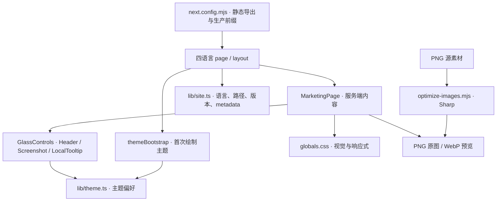

# 宣传网页设计接手记录

2026-10-24。接手时仓库 HEAD 为 `51dcbdb`，最近一次网站实现提交为 `9e2430c`（2026-10-21，网站 v1.4.0）。本记录依据本地源码、设计文档、提交历史及两张插画原图；线上版本与浏览器呈现尚未核对。

## 当前进度

| 项目 | 接手时的事实 | 依据 |
|---|---|---|
| 网站版本 | v1.4.0，独立于桌面产品版本 | [package.json](../package.json) |
| 视觉方向 | “纸雕为底、像素点睛”：暖纸底色、宋体标题、朱橙按钮，纸雕收藏夹与像素流程插画 | [DESIGN.md](../DESIGN.md#视觉来源与融合方法)、[globals.css](../app/globals.css) |
| 技术栈 | Next.js 16.3.7、React 19.2.4、Tailwind 4.3.3，静态导出 | [package.json](../package.json)、[next.config.mjs](../next.config.mjs) |
| 语言 | 简中 `/`、繁中 `/zh-TW/`、英文 `/en/`、日文 `/ja/`；生产路径前缀 `/GameLibrary` | [site.ts](../lib/site.ts:3)、[next.config.mjs](../next.config.mjs) |
| 下载 | 源码配置指向 v1.7.13，含安装版、便携版、工具包、SHA-256；这不代表本次查询过远端最新版本 | [site.ts](../lib/site.ts:7)、[MarketingPage.tsx](../components/MarketingPage.tsx:124) |
| 实机截图 | 游戏库与标签管理两张，页面标注 v1.5.5、简体中文、隔离示例库；缩略图 WebP，放大使用 PNG | [MarketingPage.tsx](../components/MarketingPage.tsx:68)、[GlassControls.tsx](../components/GlassControls.tsx:119) |
| 插画 | 已查看收藏夹与三步流程原图；它们用于概念表达，页面有概念插画说明 | [素材记录](2026-10-21-art-prompts.md)、[MarketingPage.tsx](../components/MarketingPage.tsx:41) |
| 交互 | 已实现语言与主题菜单、手机导航、截图放大、FAQ、截图加载失败提示 | [GlassControls.tsx](../components/GlassControls.tsx)、[MarketingPage.tsx](../components/MarketingPage.tsx:143) |
| 验收与发布 | 现有记录称 v1.4.0 已本地提交，未运行构建、测试或浏览器验收，未推送或部署 | [README](../README.md#本次交付与后续验收)、[DESIGN.md](../DESIGN.md#迁移回滚与验收) |

当前接手范围是 `website/`。桌面应用、宣传视频与安装器各有自己的实现和发布边界。

## 页面与架构

页面顺序为：首屏 → 扫描、确认、启动三步 → 实机大图 → 本地管理优势 → 标签收藏 → Unity 翻译 → 启动方式 → 数据与文件 → 下载 → FAQ。

`MarketingPage` 集中组织四语言内容，`GlassControls` 承担客户端交互。语言是实际路由；主题、菜单和截图窗口使用局部状态。当前结构足以支持局部设计迭代，暂不需要新增路由库、状态库或组件框架。

主题逻辑由首次绘制脚本与选择器共用：新访客默认浅色，已有 Light / Dark / System 偏好继续生效。语言与主题菜单使用原生 `details`，手机导航与截图窗口使用原生 `dialog`；后续改外观时继续复用这些行为。

## 已发现的问题与待确认项

| 性质 | 项目 | 影响与处理建议 |
|---|---|---|
| 事实 | `FrontEnd_Design/design.md` 仍描述青绿、冷灰视觉与早期版本；当前 `website/DESIGN.md` 已更新为纸雕与像素 | 后续以当前网站规范和已落地素材为基线，旧原型用于追溯。两套规范混用会把设计带回旧版。 |
| 事实 | v1.4.0 的浏览器视觉与交互验收尚未登记 | 源码中已有断点与无障碍规则，但实际效果待确认；不能沿用旧版通过记录。 |
| 事实 | 下载版本配置为 v1.7.13，截图标注 v1.5.5 | 保留截图的真实标注。若要展示新版界面，应从隔离示例库重新采集，不重绘截图里的控件。 |
| 事实与建议 | 下载卡包含“维护者于 2026-10-13 确认真机验收并授权正式发布”，发布说明链接也在下载区重复出现 | 这是维护记录与访客文案混在一起。建议将验收记录保留在项目文档，页面集中说明版本、系统要求、包的区别和校验入口，并合并重复链接。见 `MarketingPage.tsx:130–140`。 |
| 待确认 | 首屏插画与标题比例、手机首屏长度、深色底上的插画边缘 | 需要实际页面画面判断，当前不认定存在排版缺陷。 |
| 待确认 | 四语言标题换行、长下载文件名、菜单与截图窗口的键盘行为 | 需要逐项浏览器验收，已有实现不等于本版已通过验收。 |
| 待确认 | 线上部署版本与下载资产的当前可用性 | 本次未访问远端，不根据本地 README 推断线上状态。 |

工作区已有安装器及工具文件删除、`website/next-env.d.ts` 修改，以及未跟踪的原型等文件。本次只新增此记录，不把这些现有改动纳入提交。

## 下一轮设计改动范围

沿用现有视觉方向，先处理访客阅读和下载路径，再根据实际画面调整布局。以下是建议范围，尚未实施。

| 文件 | 建议改动 | 路由与状态影响 |
|---|---|---|
| `components/MarketingPage.tsx` | 精简下载卡的内部过程文案、合并发布说明入口；必要时微调首屏与实机图引导文字，四语言同步 | 保留所有语言路径、章节 ID 与下载目标 |
| `app/globals.css` | 根据实际页面调整首屏图文比例、章节间距、手机换行与下载文件名布局 | 无新增状态 |
| `components/GlassControls.tsx` | 仅在发现可复现的菜单、截图或触控问题时修改 | 沿用原生控件与局部状态 |
| `public/assets/library.png`、`tags.png` | 仅在采集到新版真实截图后替换，并同步版本说明 | 复用已有图片转换流程 |
| `DESIGN.md`、`README.md`、`docs/code-review-graph/website.md` | 随实际改动记录设计决定、图谱影响及本轮验收状态 | 不沿用历史验证结果 |
| `package.json`、`package-lock.json` | 实施网站功能或外观改动时按网站版本约定同步 | 本次文档接手保持 v1.4.0 |

组件拆分暂维持现状。只有某一章节出现重复逻辑或需要独立交互时，再提取对应组件；单纯调整排版无需拆分整页。

实施顺序：按具体需求修改页面和样式 → 同步四语言与说明 → 更新代码图谱及文档 → 本地提交。开始修改 Next.js 代码前，先阅读 `website/AGENTS.md` 要求的本机版本文档；代码修改前后调用 code-review-graph。用户明确要求预览或验证后，再运行相应命令与浏览器验收。

回滚以独立网站提交为单位，用 `git revert` 撤回页面、样式及对应说明；涉及素材或网站版本时一并撤回。推送、部署、打包和 Release 按各自的明确授权执行。

## 优先级与验收标准

| 优先级 | 工作 | 完成标准 |
|---|---|---|
| P0 | 补齐当前版实际页面验收；执行需用户明确要求预览或验证 | 四语言桌面与手机画面有证据；无横向溢出；下载、截图放大、主题保存、Escape 与焦点行为逐项记录 |
| P1 | 精简下载文案与重复入口，按验收发现调整首屏和手机排版 | 访客能识别系统要求与下载选项；四语言信息一致；现有锚点和交互保留 |
| P1 | 如需展示新版，采集真实游戏库与标签截图 | 隔离示例库、无私人路径、界面加载完成，标明实际版本和语言 |
| P2 | 按实际效果收尾插画与纸张细节 | 浅深主题中插画边缘自然、正文清晰；减弱动画与强制配色下仍可使用 |

本次只做接手审计与文档整理，已按 `humanizer` 和 `shuorenhua` 处理中文表达。没有运行测试、构建、lint、类型检查、图片生成或浏览器验收，也没有修改网页实现。
